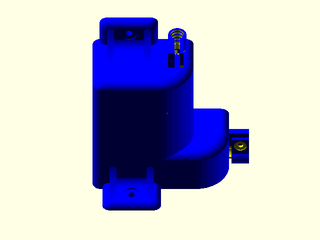

# LibFile: unfy\_powerboxes.scad

UnfyOpenSCADLib Copyright Leif Burrow 2026
kc8rwr@unfy.us
unforgettability.net

This file is part of UnfyOpenSCADLib.

unfy_powerboxes contains modules for generating boxes for power inlets and fuse holders.

## File Contents

- [`unf_mounted_power_socket_box`](#module-unf_mounted_power_socket_box)

2. [Section: Licensing](#section-licensing)

### Module: unf\_mounted\_power\_socket\_box

**Usage:** 

- unf_mounted_power_socket_box(&lt;args&gt;);

**Description:** 

Creates a box with an IEC C14 power inlet socket, a fuse holder hole and cable clips. Mounting tabs on the side and top allow it to be screwed to a surface such as the back of a desk or the side of a machine. The back is open except for a lip around the edges.

**Arguments:** 

<abbr title="These args can be used by position or by name.">By&nbsp;Position</abbr> | What it does
-------------------- | ------------
`step`               | [x, z] size of the step on the side of the box which the bottom cable clip is on ([20, 27])
`bolt_size`          | size of bolts for the mounting tabs (m4)
`back_lip`           | width of the lip around the open back (5)
`top_cable_d`        | diameter of the cable entering the top cable clip
`top_cable_bolt`     | bolt size for closing the top cable clip
`bottom_cable_d`     | diameter of the cable entering the bottom cable clip
`bottom_cable_bolt`  | bolt size for closing the bottom cable clip
`socket_fastener`    | how the C14 socket's bolts are held, "Heatset", "HexNut" or "PlainHole" (Heatset)
`socket_fastener_size` | size of the C14 socket's bolts (M4)
`fuse_holder_hole_diameter` | diameter of the hole for the fuse holder (12)
`fuse_holder_outer_diameter` | outer diameter of the fuse holder, for spacing (14)
`fuse_holder_spacing` | space around the fuse holder (4)
`fuse_holder_hole_shape` | shape of the fuse holder hole, "circle", "d" or "doubled", see unf_DHole() (circle)
`fuse_holder_flat_width` | for a "d" shaped hole the distance from the flat to the opposite side, for a "doubled" the distance between flats (5)
`fuse_holder_rotation` | rotation of the fuse holder hole (0)
`support_skin`       | thickness of support skin, 0 for none (0.6)
`wall`               | thickness of walls (4)

**Figure 1.1.1:** defaults

 

---

## Section: Licensing

UnfyOpenSCADLib is free software: you can redistribute it and/or modify it under the terms of the
GNU General Public License as published by the Free Software Foundation, either version 3 of
the License, or (at your option) any later version.

UnfyOpenSCADLib is distributed in the hope that it will be useful, but WITHOUT ANY WARRANTY;
without even the implied warranty of MERCHANTABILITY or FITNESS FOR A PARTICULAR PURPOSE.
See the GNU General Public License for more details.

You should have received a copy of the GNU General Public License along with UnfyOpenSCADLib.
If not, see <https://www.gnu.org/licenses/>.

