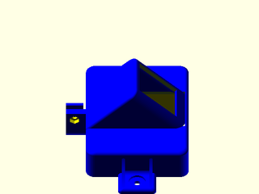

# LibFile: unfy\_switchboxes.scad

UnfyOpenSCADLib Copyright Leif Burrow 2026
kc8rwr@unfy.us
unforgettability.net

This file is part of UnfyOpenSCADLib.

unfy_switchboxes contains modules for generating boxes for switches.

## File Contents

- [`unf_mounted_power_switch_box`](#module-unf_mounted_power_switch_box)

2. [Section: Licensing](#section-licensing)

### Module: unf\_mounted\_power\_switch\_box

**Usage:** 

- unf_mounted_power_switch_box(&lt;args&gt;);

**Description:** 

Creates a box for a pop-in power switch. The switch is held in an angled face on top of a base with mounting tabs on either side, so that it may be screwed to a surface such as a desk or the side of a machine. A cable clip on the end holds the cable.

**Arguments:** 

<abbr title="These args can be used by position or by name.">By&nbsp;Position</abbr> | What it does
-------------------- | ------------
`angle`              | angle of the switch face (45)
`corner`             | radius of rounded corners (5)
`edge`               | radius of rounded edges (2)
`device`             | name of the pop-in switch, see unf_Popin() in cutouts/unfy_popins.scad (RLEIL_R2)
`device_space_z`     | space around the switch along its length (4)
`device_space_y`     | space around the switch along its width (4)
`fastener_spacing`   | distance between the mounting bolts (100)
`fastener_size`      | size of the mounting bolts (#6)
`cable_d`            | diameter of the cable (7.5)
`cable_bolt`         | bolt size for closing the cable clip (M3)
`body_color`         | color of the generated part (Blue)
`support_color`      | color of generated supports (Yellow)
`support_skin`       | thickness of support skin, 0 for none (0.6)
`max_skinless_angle` | support skin is only added to the switch opening if the face angle is greater than this (50)
`wall`               | thickness of walls (2)

**Figure 1.1.1:** defaults

  

---

## Section: Licensing

UnfyOpenSCADLib is free software: you can redistribute it and/or modify it under the terms of the
GNU General Public License as published by the Free Software Foundation, either version 3 of
the License, or (at your option) any later version.

UnfyOpenSCADLib is distributed in the hope that it will be useful, but WITHOUT ANY WARRANTY;
without even the implied warranty of MERCHANTABILITY or FITNESS FOR A PARTICULAR PURPOSE.
See the GNU General Public License for more details.

You should have received a copy of the GNU General Public License along with UnfyOpenSCADLib.
If not, see <https://www.gnu.org/licenses/>.

