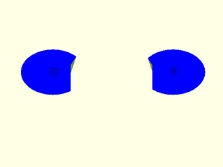
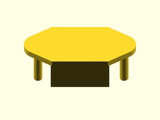
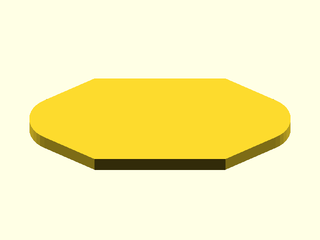
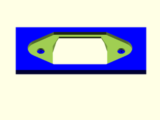

# LibFile: unfy\_c14socket.scad

UnfyOpenSCADLib Copyright Leif Burrow 2026
kc8rwr@unfy.us
unforgettability.net

This file is part of UnfyOpenSCADLib.

unfy_c14socket contains modules for creating a cutout and mount for a panel mounted IEC C14 power inlet socket, the type commonly found on computer power supplies.

## File Contents

- [`unf_C14Socket_Positive`](#module-unf_c14socket_positive)
- [`unf_C14Socket_Negative`](#module-unf_c14socket_negative)
- [`unf_C14Cape`](#module-unf_c14cape)
- [`unf_C14Body`](#module-unf_c14body)
- [`unf_C14Socket`](#module-unf_c14socket)
- [`unf_c14_size`](#function-unf_c14_size) – C14 Socket Size

2. [Section: Licensing](#section-licensing)

### Module: unf\_C14Socket\_Positive

**Usage:** 

- unf_C14Socket_Positive(&lt;args&gt;);

**Description:** 

Just the positive part of a C14 socket mount. This is the pillars which hold the socket's screws, plus any optional support skin for printing.

**Arguments:** 

<abbr title="These args can be used by position or by name.">By&nbsp;Position</abbr> | What it does
-------------------- | ------------
`bolt`               | size of the bolts which hold the socket in place (M4)
`fastener`           | how the bolts are held, "Heatset", "HexNut" or "PlainHole", case insensitive. No pillars are generated for "PlainHole". (plainhole)
`heatset_length`     | length of heatset insert, "Small", "Medium" or "Large" (Medium)
`support_skin`       | optional support for printing, "none", "horizontal" or "vertical" (none)
`support_skin_t`     | thickness of support skin, if generating supports, probably good to use the minimum your slicer will include (0.2)
`body_color`         | color of the generated part (Blue)
`support_color`      | color of generated supports (Yellow)
`restriction_l`      | if set, limits how far the pillars may extend to the left beyond the socket's ears, for fitting against nearby walls (false)
`restriction_r`      | if set, limits how far the pillars may extend to the right beyond the socket's ears, for fitting against nearby walls (false)
`wall`               | thickness of the panel the socket is mounted in (4)

**Figure 1.1.1:** fastener="Heatset"

  

---

### Module: unf\_C14Socket\_Negative

**Usage:** 

- unf_C14Socket_Negative(&lt;args&gt;);

**Description:** 

Just the negative part of a C14 socket mount. This is the cutout for the socket body, the recess for the socket's flange and the screw holes.

**Arguments:** 

<abbr title="These args can be used by position or by name.">By&nbsp;Position</abbr> | What it does
-------------------- | ------------
`bolt`               | size of the bolts which hold the socket in place (M4)
`hood_thickness`     | depth of the recess for the socket's flange (3)
`wall`               | thickness of the panel the socket is mounted in (4)

**Figure 1.2.1:** defaults

  

---

### Module: unf\_C14Cape

**Usage:** 

- unf_C14Cape(&lt;args&gt;);

**Description:** 

The shape of the flange (cape) around the front of a C14 socket, including the ears with the screw holes. Used for cutting a recess for the flange or for support skins.

**Arguments:** 

<abbr title="These args can be used by position or by name.">By&nbsp;Position</abbr> | What it does
-------------------- | ------------
`hood_thickness`     | thickness of the flange (3)

**Figure 1.3.1:** defaults

  

---

### Module: unf\_C14Body

**Usage:** 

- unf_C14Body(&lt;args&gt;);

**Description:** 

The shape of the body of a C14 socket, behind the flange. Used for cutting the hole that the socket fits through.

**Arguments:** 

<abbr title="These args can be used by position or by name.">By&nbsp;Position</abbr> | What it does
-------------------- | ------------
`depth`              | depth of the body (18)

**Figure 1.4.1:** defaults

  

---

### Module: unf\_C14Socket

**Usage:** 

- unf_C14Socket(&lt;args&gt;){ &nbsp;&nbsp;&nbsp;child_stuff(); }

**Description:** 

Operator module that uses unf_C14Socket_Positive() and unf_C14Socket_Negative() to cut a C14 socket hole through the child object(s) and add any mounting pillars.

**Arguments:** 

<abbr title="These args can be used by position or by name.">By&nbsp;Position</abbr> | What it does
-------------------- | ------------
`location`           | where to place the socket relative to the child/childrens' origin ([0, 0, 0])
`rotation`           | how to orientate the socket relative to the child/children objects (0)
`hood_thickness`     | depth of the recess for the socket's flange (3)
`bolt`               | size of the bolts which hold the socket in place (M4)
`fastener`           | how the bolts are held, "Heatset", "HexNut" or "PlainHole", case insensitive (plainhole)
`heatset_length`     | length of heatset insert, "Small", "Medium" or "Large" (Medium)
`support_skin`       | optional support for printing, "none", "horizontal" or "vertical" (none)
`support_skin_t`     | thickness of support skin, if generating supports, probably good to use the minimum your slicer will include (0.2)
`body_color`         | color of the generated part (Blue)
`support_color`      | color of generated supports (Yellow)
`restriction_l`      | if set, limits how far the pillars may extend to the left beyond the socket's ears, for fitting against nearby walls (false)
`restriction_r`      | if set, limits how far the pillars may extend to the right beyond the socket's ears, for fitting against nearby walls (false)
`wall`               | thickness of the panel the socket is mounted in (4)

**Figure 1.5.1:** fastener="Heatset"

 

---

### Function: unf\_c14\_size

**Synopsis:** C14 Socket Size

**Usage:** 

- unf_c14_size()

**Description:** 

Returns the [x, y] size of the front of a C14 socket including the ears.

---

## Section: Licensing

UnfyOpenSCADLib is free software: you can redistribute it and/or modify it under the terms of the
GNU General Public License as published by the Free Software Foundation, either version 3 of
the License, or (at your option) any later version.

UnfyOpenSCADLib is distributed in the hope that it will be useful, but WITHOUT ANY WARRANTY;
without even the implied warranty of MERCHANTABILITY or FITNESS FOR A PARTICULAR PURPOSE.
See the GNU General Public License for more details.

You should have received a copy of the GNU General Public License along with UnfyOpenSCADLib.
If not, see <https://www.gnu.org/licenses/>.

