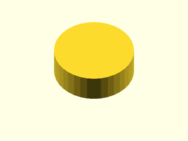

# LibFile: unfy\_dhole.scad

UnfyOpenSCADLib Copyright Leif Burrow 2026
kc8rwr@unfy.us
unforgettability.net

This file is part of UnfyOpenSCADLib.

unfy_dhole contains a module for creating D, double-D and round holes for mounting panel components such as fuse holders, toggle switches, potentiometers, etc...

## File Contents

- [`unf_DHole`](#module-unf_dhole)

2. [Section: Licensing](#section-licensing)

### Module: unf\_DHole

**Usage:** 

- unf_DHole(&lt;args&gt;);

**Description:** 

Creates d, double-d and circle shapes for cutouts such as fuse holder, toggle switch, etc.. mounts.
Reason for circle (which could obviously be done without this) is to make easy user-customization, the shape may be passed straight through from a customizer drop-down.

**Arguments:** 

<abbr title="These args can be used by position or by name.">By&nbsp;Position</abbr> | What it does
-------------------- | ------------
`diameter`           | diameter of the fully round part of the circle (11.3)
`flat_width`         | for a d-shape, distance from flat to opposite side of circle. For a double-d, distance between flats. Ignored for a circle. (10.54)
`angle`              | rotation angle, 0 is flat on top, rotates counter-clockwise (0)
`z`                  | depth of hole to make (4)
`shape`              | "d", "doubled" or "circle", case insensitive (d)

**Figure 1.1.1:** defaults

  

**Figure 1.1.2:** shape="DoubleD", flat\_width=8

  

**Figure 1.1.3:** shape="circle"

  

---

## Section: Licensing

UnfyOpenSCADLib is free software: you can redistribute it and/or modify it under the terms of the
GNU General Public License as published by the Free Software Foundation, either version 3 of
the License, or (at your option) any later version.

UnfyOpenSCADLib is distributed in the hope that it will be useful, but WITHOUT ANY WARRANTY;
without even the implied warranty of MERCHANTABILITY or FITNESS FOR A PARTICULAR PURPOSE.
See the GNU General Public License for more details.

You should have received a copy of the GNU General Public License along with UnfyOpenSCADLib.
If not, see <https://www.gnu.org/licenses/>.

