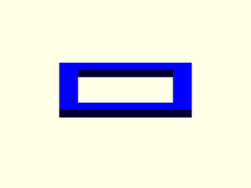
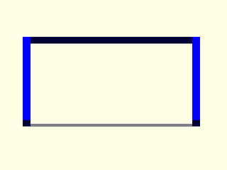
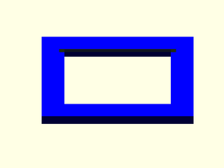

# LibFile: unfy\_popins.scad

UnfyOpenSCADLib Copyright Leif Burrow 2026
kc8rwr@unfy.us
unforgettability.net

This file is part of UnfyOpenSCADLib.

unfy_popins contains modules for creating cutouts and mounts for simple rectangular parts such as switches and panel meters which push into a hole and have fingers that grab. Parts may be selected by name so that the end user may choose a part from a customizer drop-down.

## File Contents

1. [Section: Custom Pop-ins](#section-custom-pop-ins)
    - [`unf_PopinCustom_Negative`](#module-unf_popincustom_negative)
    - [`unf_PopinCustom_Positive`](#module-unf_popincustom_positive)

2. [Section: Pop-ins by Name](#section-pop-ins-by-name)
    - [`unf_Popin_Positive`](#module-unf_popin_positive)
    - [`unf_Popin_Negative`](#module-unf_popin_negative)
    - [`unf_Popin_Dims`](#function-unf_popin_dims) – Pop-in Dimensions by Name
    - [`unf_Popin`](#module-unf_popin)

3. [Section: Switches](#section-switches)
    - [`unf_rleil_rl2_popin`](#module-unf_rleil_rl2_popin)
    - [`unf_rleil_rl2_cutout`](#module-unf_rleil_rl2_cutout)
    - [`unf_rleil_r2_dims`](#function-unf_rleil_r2_dims) – RLEIL RL2 Dimensions

4. [Section: Meters](#section-meters)
    - [`unf_yb4835va_cutout`](#module-unf_yb4835va_cutout)
    - [`unf_yb4835va_popin`](#module-unf_yb4835va_popin)
    - [`unf_yb4835va_dims`](#function-unf_yb4835va_dims) – YB4835VA Dimensions

5. [Section: Licensing](#section-licensing)

## Section: Custom Pop-ins

Modules for pop-ins of any size. These are used by the named parts below, and may be used directly for parts which are not yet included.

### Module: unf\_PopinCustom\_Negative

**Usage:** 

- unf_PopinCustom_Negative(&lt;args&gt;);

**Description:** 

The cutout for a pop-in part of any size. The cutout is the size of the opening plus the ridge on each side, it is partially filled back in by unf_PopinCustom_Positive().

**Arguments:** 

<abbr title="These args can be used by position or by name.">By&nbsp;Position</abbr> | What it does
-------------------- | ------------
`size`               | [x, y] size of the opening the part pushes through ([10, 5])
`ridge`              | [x, y] width of the ledge on each side of the opening which the part's fingers grab ([2, 1])
`extra`              | how far beyond the wall to extend the cutout (5)
`wall`               | thickness of the panel the part is mounted in (2)

**Figure 1.1.1:** defaults

  

---

### Module: unf\_PopinCustom\_Positive

**Usage:** 

- unf_PopinCustom_Positive(&lt;args&gt;);

**Description:** 

The positive part for a pop-in part of any size. This is a ledge around the opening, thin enough for the part's fingers to grab, plus any optional support skin for printing.

**Arguments:** 

<abbr title="These args can be used by position or by name.">By&nbsp;Position</abbr> | What it does
-------------------- | ------------
`size`               | [x, y] size of the opening the part pushes through ([10, 5])
`catch_thickness`    | thickness of the ledge which the part's fingers grab (1.2)
`ridge`              | [x, y] width of the ledge on each side of the opening which the part's fingers grab ([2, 1])
`wall`               | thickness of the panel the part is mounted in (2)
`body_color`         | color of the generated part (Blue)
`support_color`      | color of generated supports (Yellow)
`support_skin`       | thickness of support skin, 0 for none (0)

**Figure 1.2.1:** defaults

  

---

## Section: Pop-ins by Name

### Module: unf\_Popin\_Positive

**Usage:** 

- unf_Popin_Positive(device, &lt;args&gt;);

**Description:** 

Call a popin switch module by name.

**Arguments:** 

<abbr title="These args can be used by position or by name.">By&nbsp;Position</abbr> | What it does
-------------------- | ------------
`device`             | name of the part, "RLEIL_R2" or "YB4835VA", case insensitive. Anything after a "|" is ignored, so a description may be included for display in a customizer drop-down.

<abbr title="These args must be used by name, ie: name=value">By&nbsp;Name</abbr> | What it does
-------------------- | ------------
`wall`               | thickness of the panel the part is mounted in (2)
`body_color`         | color of the generated part (Blue)
`support_color`      | color of generated supports (Yellow)
`support_skin`       | thickness of support skin, 0 for none (0)

**Figure 2.1.1:** device="RLEIL\_R2"

  

---

### Module: unf\_Popin\_Negative

**Usage:** 

- unf_Popin_Negative(device, &lt;args&gt;);

**Description:** 

Call a popin switch cutout module by name.

**Arguments:** 

<abbr title="These args can be used by position or by name.">By&nbsp;Position</abbr> | What it does
-------------------- | ------------
`device`             | name of the part, "RLEIL_R2" or "YB4835VA", case insensitive. Anything after a "|" is ignored.

<abbr title="These args must be used by name, ie: name=value">By&nbsp;Name</abbr> | What it does
-------------------- | ------------
`wall`               | thickness of the panel the part is mounted in (2)

**Figure 2.2.1:** device="RLEIL\_R2"

  

---

### Function: unf\_Popin\_Dims

**Synopsis:** Pop-in Dimensions by Name

**Usage:** 

- unf_Popin_Dims(device)

**Description:** 

Get a popin switch's dimensions by name. Returns [0, 0] for an unknown part.

**Arguments:** 

<abbr title="These args can be used by position or by name.">By&nbsp;Position</abbr> | What it does
-------------------- | ------------
`device`             | name of the part, "RLEIL_R2" or "YB4835VA", case insensitive. Anything after a "|" is ignored.

---

### Module: unf\_Popin

**Usage:** 

- unf_Popin(&lt;args&gt;){ &nbsp;&nbsp;&nbsp;child_stuff(); }

**Description:** 

Operator module that uses unf_Popin_Positive() and unf_Popin_Negative() to cut out and build up a popin by name on the child object(s).

**Arguments:** 

<abbr title="These args can be used by position or by name.">By&nbsp;Position</abbr> | What it does
-------------------- | ------------
`location`           | where to place the pop-in relative to the child/childrens' origin ([0, 0, 0])
`rotation`           | how to orientate the pop-in relative to the child/children objects (0)
`device`             | name of the part, "RLEIL_R2" or "YB4835VA", case insensitive. Anything after a "|" is ignored. (rleil_r2)
`wall`               | thickness of the panel the part is mounted in (2)
`body_color`         | color of the generated part (Blue)
`support_color`      | color of generated supports (Yellow)
`support_skin`       | thickness of support skin, 0 for none (0)
`do_render`          | wrap the positive and negative parts in render(), which may speed up previews of complex models (false)

**Figure 2.4.1:** device="RLEIL\_R2"

  

---

## Section: Switches

### Module: unf\_rleil\_rl2\_popin

**Usage:** 

- unf_rleil_rl2_popin(&lt;args&gt;);

**Description:** 

The positive part for a RLEIL RL2 series Rocker Switch.

**Arguments:** 

<abbr title="These args can be used by position or by name.">By&nbsp;Position</abbr> | What it does
-------------------- | ------------
`wall`               | thickness of the panel the switch is mounted in (2)
`body_color`         | color of the generated part (Blue)
`support_color`      | color of generated supports (Yellow)
`support_skin`       | thickness of support skin, 0 for none (0)

---

### Module: unf\_rleil\_rl2\_cutout

**Usage:** 

- unf_rleil_rl2_cutout(&lt;args&gt;);

**Description:** 

The cutout for a RLEIL RL2 series Rocker Switch.

**Arguments:** 

<abbr title="These args can be used by position or by name.">By&nbsp;Position</abbr> | What it does
-------------------- | ------------
`wall`               | thickness of the panel the switch is mounted in (2)

---

### Function: unf\_rleil\_r2\_dims

**Synopsis:** RLEIL RL2 Dimensions

**Usage:** 

- unf_rleil_r2_dims()

**Description:** 

Returns the [x, y, z] dimensions of a RLEIL RL2 series Rocker Switch.

---

## Section: Meters

### Module: unf\_yb4835va\_cutout

**Usage:** 

- unf_yb4835va_cutout(&lt;args&gt;);

**Description:** 

The cutout for a YB4835VA Digital Volt/Amp Panel Meter.

**Arguments:** 

<abbr title="These args can be used by position or by name.">By&nbsp;Position</abbr> | What it does
-------------------- | ------------
`wall`               | thickness of the panel the meter is mounted in (2)

---

### Module: unf\_yb4835va\_popin

**Usage:** 

- unf_yb4835va_popin(&lt;args&gt;);

**Description:** 

The positive part for a YB4835VA Digital Volt/Amp Panel Meter.

**Arguments:** 

<abbr title="These args can be used by position or by name.">By&nbsp;Position</abbr> | What it does
-------------------- | ------------
`wall`               | thickness of the panel the meter is mounted in (2)
`body_color`         | color of the generated part (Blue)
`support_color`      | color of generated supports (Yellow)
`support_skin`       | thickness of support skin, 0 for none (0)

---

### Function: unf\_yb4835va\_dims

**Synopsis:** YB4835VA Dimensions

**Usage:** 

- unf_yb4835va_dims()

**Description:** 

Returns the [x, y] dimensions of a YB4835VA Digital Volt/Amp Panel Meter.

---

## Section: Licensing

UnfyOpenSCADLib is free software: you can redistribute it and/or modify it under the terms of the
GNU General Public License as published by the Free Software Foundation, either version 3 of
the License, or (at your option) any later version.

UnfyOpenSCADLib is distributed in the hope that it will be useful, but WITHOUT ANY WARRANTY;
without even the implied warranty of MERCHANTABILITY or FITNESS FOR A PARTICULAR PURPOSE.
See the GNU General Public License for more details.

You should have received a copy of the GNU General Public License along with UnfyOpenSCADLib.
If not, see <https://www.gnu.org/licenses/>.

