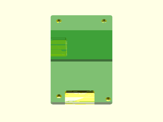
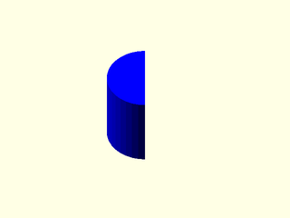

# LibFile: unfy\_boards.scad

UnfyOpenSCADLib Copyright Leif Burrow 2026
kc8rwr@unfy.us
unforgettability.net

This file is part of UnfyOpenSCADLib.

unfy_boards contains a collection of modules for generating common maker PCBs, mockups, their drill holes and standoffs.

## File Contents

1. [Section: Boards](#section-boards)
    - [`rak19007`](#module-rak19007)

2. [Section: Standoffs](#section-standoffs)
    - [`standoff`](#module-standoff)

3. [Section: Licensing](#section-licensing)

## Section: Boards

### Module: rak19007

**Usage:** 

- rak19007(&lt;args&gt;);

**Description:** 

Creates a mockup of a RAKwireless RAK19007 WisBlock base board, with its mounting holes and cutouts. The board is rendered as a transparent background (%) object so it shows in preview but is not part of the rendered model.

**Arguments:** 

<abbr title="These args can be used by position or by name.">By&nbsp;Position</abbr> | What it does
-------------------- | ------------
`show_board`         | show the board mockup (true)
`standoff_height`    | height of the bottom of the board above the origin (5)
`pcb_color`          | color of the board (green)
`subtraction_color`  | color of the holes and cutouts in the board (yellow)
`support_color`      | color of any generated supports (gray)

**Figure 1.1.1:** defaults

  

---

## Section: Standoffs

### Module: standoff

**Usage:** 

- standoff(&lt;args&gt;);

**Description:** 

Creates a standoff for mounting a board. Render once with positive=true to create the standoff itself and once with positive=false to create the bolt hole and nut trap to subtract from it.

**Arguments:** 

<abbr title="These args can be used by position or by name.">By&nbsp;Position</abbr> | What it does
-------------------- | ------------
`positive`           | true to create the standoff, false to create the hole to subtract from it (true)
`type`               | how the bolt is held, one of "bottom_heatset", "top_heatset", "bottom_nut", "side_nut" or "self_tapping" (bottom_heatset)
`bolt_size`          | bolt size (m3)
`base_ext`           | how far the bolt hole extends below the standoff into the part it is mounted on (2.5)
`height`             | height of the standoff (5)
`wall_ext`           | how far the base of the standoff extends down into the wall it is mounted on (1)
`heatset_length`     | length of heatset insert, "small", "medium" or "large" (medium)

**Figure 2.1.1:** defaults, cut away to show the hole

  

---

## Section: Licensing

UnfyOpenSCADLib is free software: you can redistribute it and/or modify it under the terms of the
GNU General Public License as published by the Free Software Foundation, either version 3 of
the License, or (at your option) any later version.

UnfyOpenSCADLib is distributed in the hope that it will be useful, but WITHOUT ANY WARRANTY;
without even the implied warranty of MERCHANTABILITY or FITNESS FOR A PARTICULAR PURPOSE.
See the GNU General Public License for more details.

You should have received a copy of the GNU General Public License along with UnfyOpenSCADLib.
If not, see <https://www.gnu.org/licenses/>.

