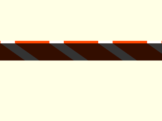
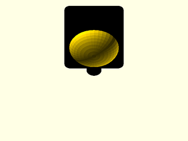
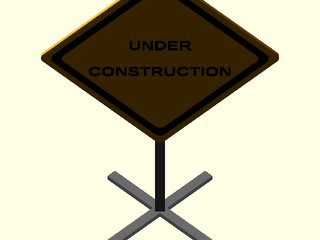
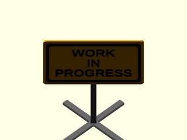
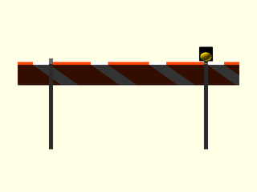
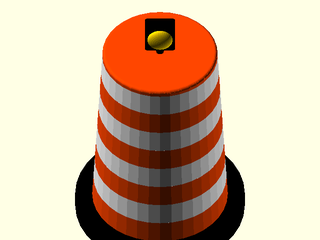
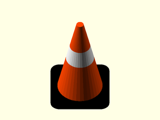
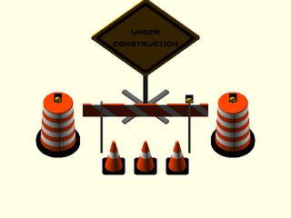
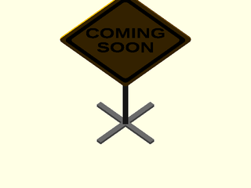

# LibFile: unfy\_construction.scad

UnfyOpenSCADLib Copyright Leif Burrow 2026
kc8rwr@unfy.us
unforgettability.net

This file is part of UnfyOpenSCADLib.

unfy_construction contains modules for generating an "under construction" scene: a sign with a custom
message, striped barricades (sawhorses), drums (barrels), traffic cones and warning lights. Useful as a
placeholder in an unfinished design or just for fun.

This file was created with help from Claude.

## File Contents

- [`unf_cnst_split`](#function-unf_cnst_split)
- [`unf_cnst_text_block`](#module-unf_cnst_text_block)
- [`unf_cnst_striped_board`](#module-unf_cnst_striped_board)
- [`unf_construction_light`](#module-unf_construction_light)
- [`unf_construction_sign`](#module-unf_construction_sign)
- [`unf_construction_barricade`](#module-unf_construction_barricade)
- [`unf_construction_barrel`](#module-unf_construction_barrel)
- [`unf_construction_cone`](#module-unf_construction_cone)
- [`unf_construction_scene`](#module-unf_construction_scene)

2. [Section: Licensing](#section-licensing)

### Function: unf\_cnst\_split

**Usage:** 

- lines = unf_cnst_split(str, sep);

**Description:** 

Splits a string into a list of strings on a single separator character. A list passed in is returned unchanged.

**Arguments:** 

<abbr title="These args can be used by position or by name.">By&nbsp;Position</abbr> | What it does
-------------------- | ------------
`str`                | the string to split, or a list of strings
`sep`                | the single-character separator ("|")

---

### Module: unf\_cnst\_text\_block

**Usage:** 

- unf_cnst_text_block(&lt;args&gt;);

**Description:** 

Creates 2d, centered, multi-line text scaled to fit within the given width and height.

**Arguments:** 

<abbr title="These args can be used by position or by name.">By&nbsp;Position</abbr> | What it does
-------------------- | ------------
`lines`              | a list of strings, one per line
`size`               | [width, height] of the area the text must fit within
`font`               | font to use ("Liberation Sans:style=Bold")

---

### Module: unf\_cnst\_striped\_board

**Usage:** 

- unf_cnst_striped_board(&lt;args&gt;);

**Description:** 

Creates a flat board with diagonal hazard stripes. The board lies in the XZ plane, centered on X, with its front face at y=0 and its back at y=size.y.

**Arguments:** 

<abbr title="These args can be used by position or by name.">By&nbsp;Position</abbr> | What it does
-------------------- | ------------
`size`               | [length, thickness, height] of the board
`stripe_width`       | width of each stripe measured along the board (size.z)
`angle`              | angle of the stripes (45)
`stripes`            | true for stripes, false for a plain board (true)
`stripe_color`       | color of the stripes ("OrangeRed")
`stripe_alt_color`   | color between the stripes ("White")

**Figure 1.3.1:** defaults

  

---

### Module: unf\_construction\_light

**Usage:** 

- unf_construction_light(&lt;args&gt;);

**Description:** 

Creates a barricade warning light: a housing with a domed lens facing forward (-Y). The origin is at the bottom center of the housing.

**Arguments:** 

<abbr title="These args can be used by position or by name.">By&nbsp;Position</abbr> | What it does
-------------------- | ------------
`size`               | width of the housing, everything else is scaled from this (10)
`housing_color`      | color of the housing ("Black")
`lens_color`         | color of the lens ("Gold")

**Figure 1.4.1:** defaults

  

---

### Module: unf\_construction\_sign

**Usage:** 

- unf_construction_sign(&lt;args&gt;);

**Description:** 

Creates a road-work style sign with a message on a post and folding X base. The sign faces -Y and the origin is at the center of the base on the ground.

**Arguments:** 

<abbr title="These args can be used by position or by name.">By&nbsp;Position</abbr> | What it does
-------------------- | ------------
`message`            | text to show, either a string with lines separated by line_separator or a list of strings ("UNDER CONSTRUCTION")
`size`               | side length of a diamond sign or width of a rectangular sign (100)
`shape`              | "diamond" or "rectangle" ("diamond")
`height`             | height of the bottom of the sign above the ground (60)
`thickness`          | thickness of the sign panel (2)
`line_separator`     | character separating lines in message ("|")
`font`               | font for the message ("Liberation Sans:style=Bold")
`sign_color`         | color of the sign panel ("Orange")
`text_color`         | color of the message and border ("Black")
`frame_color`        | color of the post and base ("DimGray")

**Figure 1.5.1:** defaults

  

**Figure 1.5.2:** rectangle, multi-line

 

---

### Module: unf\_construction\_barricade

**Usage:** 

- unf_construction_barricade(&lt;args&gt;);

**Description:** 

Creates a sawhorse style barricade: a striped board atop two A-frame leg sets, optionally with a warning light. The board faces -Y and the origin is at the center of the barricade on the ground.

**Arguments:** 

<abbr title="These args can be used by position or by name.">By&nbsp;Position</abbr> | What it does
-------------------- | ------------
`length`             | length of the board (160)
`height`             | height to the top of the board (70)
`board_height`       | height of the striped board (height * 0.3)
`thickness`          | thickness of the board and legs (3)
`stripes`            | show hazard stripes (true)
`light`              | show a warning light on one end (true)
`light_size`         | size of the warning light (10)
`stripe_color`       | color of the stripes ("OrangeRed")
`stripe_alt_color`   | color between the stripes ("White")
`frame_color`        | color of the legs ("DimGray")
`lens_color`         | color of the light's lens ("Gold")

**Figure 1.6.1:** defaults

  

---

### Module: unf\_construction\_barrel

**Usage:** 

- unf_construction_barrel(&lt;args&gt;);

**Description:** 

Creates a traffic drum (barrel) with alternating reflective bands, a weighted base ring and optionally a warning light on top. The origin is at the center of the base on the ground.

**Arguments:** 

<abbr title="These args can be used by position or by name.">By&nbsp;Position</abbr> | What it does
-------------------- | ------------
`diameter`           | diameter at the base of the drum (45)
`height`             | height of the drum, not including the light (70)
`bands`              | number of colored bands, alternating with stripe_alt_color (4)
`light`              | show a warning light on top (true)
`light_size`         | size of the warning light (10)
`stripe_color`       | color of the bands ("OrangeRed")
`stripe_alt_color`   | color between the bands ("White")
`base_color`         | color of the base ring ("Black")
`lens_color`         | color of the light's lens ("Gold")

**Figure 1.7.1:** defaults

  

---

### Module: unf\_construction\_cone

**Usage:** 

- unf_construction_cone(&lt;args&gt;);

**Description:** 

Creates a traffic cone on a square base with a reflective collar. The origin is at the center of the base on the ground.

**Arguments:** 

<abbr title="These args can be used by position or by name.">By&nbsp;Position</abbr> | What it does
-------------------- | ------------
`height`             | overall height (45)
`cone_color`         | color of the cone ("OrangeRed")
`band_color`         | color of the reflective collar ("White")
`base_color`         | color of the base ("Black")

**Figure 1.8.1:** defaults

  

---

### Module: unf\_construction\_scene

**Usage:** 

- unf_construction_scene(&lt;args&gt;);

**Description:** 

Creates a complete "under construction" scene. A sign stands behind a barricade which is flanked by barrels with a row of cones in front. Each detail may be turned on or off. The scene faces -Y and the origin is at the center of the barricade on the ground.

**Arguments:** 

<abbr title="These args can be used by position or by name.">By&nbsp;Position</abbr> | What it does
-------------------- | ------------
`message`            | text on the sign, either a string with lines separated by line_separator or a list of strings ("UNDER CONSTRUCTION")
`show_sign`          | show the sign (true)
`show_barricade`     | show the barricade (true)
`show_barrels`       | show barrels beside the barricade (true)
`barrel_count`       | number of barrels, alternating sides (2)
`show_cones`         | show a row of cones in front (true)
`cone_count`         | number of cones (3)
`show_lights`        | show warning lights on the barricade and barrels (true)
`show_stripes`       | show hazard stripes on the barricade (true)
`sign_shape`         | "diamond" or "rectangle" ("diamond")
`sign_size`          | side of a diamond sign or width of a rectangular one (100)
`sign_height`        | height of the bottom of the sign above the ground (60)
`barricade_length`   | length of the barricade (160)
`barricade_height`   | height of the barricade (70)
`barrel_diameter`    | diameter of the barrels (45)
`barrel_height`      | height of the barrels (70)
`cone_height`        | height of the cones (45)
`light_size`         | size of the warning lights (10)
`line_separator`     | character separating lines in message ("|")
`font`               | font for the message ("Liberation Sans:style=Bold")
`sign_color`         | color of the sign ("Orange")
`text_color`         | color of the message and sign border ("Black")
`stripe_color`       | color of stripes, bands and cones ("OrangeRed")
`stripe_alt_color`   | color between stripes and bands ("White")
`frame_color`        | color of posts and legs ("DimGray")
`base_color`         | color of barrel and cone bases ("Black")
`lens_color`         | color of the warning light lenses ("Gold")

**Figure 1.9.1:** defaults

  

**Figure 1.9.2:** sign only, custom message

 

---

## Section: Licensing

UnfyOpenSCADLib is free software: you can redistribute it and/or modify it under the terms of the
GNU General Public License as published by the Free Software Foundation, either version 3 of
the License, or (at your option) any later version.

UnfyOpenSCADLib is distributed in the hope that it will be useful, but WITHOUT ANY WARRANTY;
without even the implied warranty of MERCHANTABILITY or FITNESS FOR A PARTICULAR PURPOSE.
See the GNU General Public License for more details.

You should have received a copy of the GNU General Public License along with UnfyOpenSCADLib.
If not, see <https://www.gnu.org/licenses/>.

