# LibFile: unfy\_fasteners.scad

UnfyOpenSCADLib Copyright Leif Burrow 2026
kc8rwr@unfy.us
unforgettability.net

This file is part of UnfyOpenSCADLib.

Unfy_fasteners.scad contains modules for creating bolts, self tapping screws, nuts, washers, heatsink inserts and more. These models at the time do not include threads. Their purpose is for subtracting from a model to create holes and countersinks. Realistic models with threads could be added later if there is a use for them.

Fasteners may be generated to size by passing the size as a string. Metric sizes may be passed as "M&lt;number&gt;" such as "M4" or "M3". It is case insensitive so "m4" or "m3" will work as well. Numbered SAE sizes are represented as "#&lt;number&gt;", such as "#6" or "#8". Inch sizes are represented as a decimal number or as a fraction. "1/4" or "0.25" would both represent 1/4". ISO tapping screw sizes may be passed as "ST&lt;number&gt;" such as "ST2.9". These are treated as the metric size of the same diameter by the fasteners that are not self tapping screws.

Tables are included for looking up dimensions based on these sizes. Shaft diameter of course is the size itself in it's respective units. Tables also include things like typical diameters and thicknesses of heads for various bolt types, nut, washer and heatset insert dimensions, etc... Most sizes commonly used in 3d-printed projects as well as larger fasteners commonly available in hardware stores are included. If sizes that are outside of the built in tables are requested then the code will attempt to interpolate the missing value.

Functions are included to look up the various dimensions of fasteners by size and type. This way one using this library may allow the end user to choose fastener sizes from the customizer menu. Then the script may adapt, re-sizing or re-positioning things based on the outer dimensions of the requested fastener sizes. Sizes may be looked up as scalars describing just one dimension. Or they may be looked up as a vector which may then be passed to the functions that look up the individual dimensions or the module which renders the part. This way the lookup and/or interpolation need only happen once.

The goal here is to allow the user to create customizable designs where the end user may choose parts that they already have on hand or parts that are easily available. Designers are encouraged to give the end-user plenty of choices. Perfectly valid arguments regarding the merits of measurement systems aside, the best fastener size is the one you already have on hand. The next best is the one your local hardware store sells in bulk rather than the specialty isle.

Provisions are included for distorting horizontal bolt holes, to remove some extra material from the top side. This way when printing via fused filament fabrication plastic which sags down will just cancel this distortion out rather than requiring drilling so the bolt can fit cleanly. The distortion is defined by two special variables, $unf-hdist_y and $unf_hdist_x. These define the extra removed material by height and width respectively, both as a percentage of the shaft diameter.

So far this feature has been developed only for bolt holes and not the other parts. The original intention was to distort every part depending on the angle at which it is rendered. Unfortunately there is no good way to know what angle a part is being rendered in OpenSCAD so it relies on the user telling it. Thus this feature has not been furtner developed.

## File Contents

- [`unf_fnr_type`](#function-unf_fnr_type) – Fastener Type
- [`unf_fnr_size`](#function-unf_fnr_size) – Fastener Size
- [`unf_fnr_diameter`](#function-unf_fnr_diameter) – Fastener Clearance Diameter
- [`unf_fnr_is_st`](#function-unf_fnr_is_st) – Is this an ISO tapping screw size
- [`unf_fnr_st_to_m`](#function-unf_fnr_st_to_m) – Convert an ISO tapping screw size to a metric size
- [`unf_fnr_shaft_diameter`](#function-unf_fnr_shaft_diameter) – Fastener Shaft Diameter

2. [Section: Distorted Shafts](#section-distorted-shafts)
    - [`unf_shaft`](#module-unf_shaft) – Fastener Shaft
    - [`distortion_test_block`](#module-distortion_test_block) – Shaft Distortion Test Block

3. [Section: Cap Bolts - unf\_cap\_*](#section-cap-bolts---unf_cap_)
    - [`unf_cap_v`](#function-unf_cap_v) – Cap Head Bolt Vector
    - [`unf_cap_head_diameter`](#function-unf_cap_head_diameter) – Cap Head Bolt Clearance Diameter
    - [`unf_cap_head_height`](#function-unf_cap_head_height) – Cap Head Bolt Head Height
    - [`unf_cap_default_length`](#function-unf_cap_default_length) – Cap Head Bolt Default Length
    - [`unf_cap`](#module-unf_cap) – Cap Head Bolt

4. [Section: Countersunk Bolts - unf\_csk\_*](#section-countersunk-bolts---unf_csk_)
    - [`unf_csk_v`](#function-unf_csk_v) – Counter Sunk Bolt Vector
    - [`unf_csk_head_diameter`](#function-unf_csk_head_diameter) – Countersunk Head Clearance Diameter
    - [`unf_csk_head_height`](#function-unf_csk_head_height) – Countersunk Head Height
    - [`unf_csk_default_length`](#function-unf_csk_default_length) – Countersunk Bolt Default Length
    - [`unf_csk`](#module-unf_csk) – Countersunk Bolt

5. [Section: Hex Head Bolts - unf\_hex\_*](#section-hex-head-bolts---unf_hex_)
    - [`unf_hex_v`](#function-unf_hex_v) – Hex Head Bolt Vector
    - [`unf_hex_head_diameter`](#function-unf_hex_head_diameter) – Hex Head Bolt Clearance Diameter
    - [`unf_hex_head_height`](#function-unf_hex_head_height) – Hex Head Height
    - [`unf_hex_default_length`](#function-unf_hex_default_length) – Hex Head Bolt Default Length
    - [`unf_hex`](#module-unf_hex) – Hex Head Bolt

6. [Section: Self Tapping Screws - unf\_stp\_*](#section-self-tapping-screws---unf_stp_)
    - [`unf_stp_v`](#function-unf_stp_v) – Self Tapping Screw Vector
    - [`unf_stp_head_style`](#function-unf_stp_head_style) – Self Tapping Screw Head Style
    - [`unf_stp_head_shape`](#function-unf_stp_head_shape) – Self Tapping Screw Head Shape
    - [`unf_stp_is_imperial`](#function-unf_stp_is_imperial) – Is this a numbered or inch size
    - [`unf_stp_inch`](#function-unf_stp_inch) – Convert a table in inches to mm
    - [`unf_stp_lookup`](#function-unf_stp_lookup) – Self Tapping Screw Table Lookup
    - [`unf_stp_head_table`](#function-unf_stp_head_table) – Self Tapping Screw Head Table
    - [`unf_stp_head_diameter`](#function-unf_stp_head_diameter) – Self Tapping Screw Head Clearance Diameter
    - [`unf_stp_head_height`](#function-unf_stp_head_height) – Self Tapping Screw Head Height
    - [`unf_stp_default_length`](#function-unf_stp_default_length) – Self Tapping Screw Default Length
    - [`unf_stp_minor_diameter`](#function-unf_stp_minor_diameter) – Self Tapping Screw Minor Diameter
    - [`unf_stp_clearance_diameter`](#function-unf_stp_clearance_diameter) – Self Tapping Screw Clearance Hole Diameter
    - [`unf_stp_pitch`](#function-unf_stp_pitch) – Self Tapping Screw Thread Pitch
    - [`unf_stp_engagement`](#function-unf_stp_engagement) – Self Tapping Screw Recommended Engagement
    - [`unf_default_nozzle`](#function-unf_default_nozzle) – Printer Nozzle Diameter
    - [`unf_stp_default_pilot_id`](#function-unf_stp_default_pilot_id) – Default Star Pilot Inner Diameter Percentage
    - [`unf_stp_default_pilot_od`](#function-unf_stp_default_pilot_od) – Default Star Pilot Outer Diameter Percentage
    - [`unf_stp_pilot_id`](#function-unf_stp_pilot_id) – Self Tapping Screw Star Pilot Inner Diameter
    - [`unf_stp_pilot_od`](#function-unf_stp_pilot_od) – Self Tapping Screw Star Pilot Outer Diameter
    - [`unf_stp_pilot_diameter`](#function-unf_stp_pilot_diameter) – Self Tapping Screw Round Pilot Diameter
    - [`unf_stp_star_points`](#function-unf_stp_star_points) – Self Tapping Screw Star Pilot Point Count
    - [`unf_stp_pilot`](#module-unf_stp_pilot) – Self Tapping Screw Pilot Hole
    - [`unf_stp`](#module-unf_stp) – Self Tapping Screw

7. [Section: Heatset Inserts - unf\_hst\_*](#section-heatset-inserts---unf_hst_)
    - [`unf_hst_v`](#function-unf_hst_v) – Heatset Insert Vector
    - [`unf_hst_diameter`](#function-unf_hst_diameter) – Heatset Insert Diameter
    - [`unf_hst_length`](#function-unf_hst_length) – Heatset Insert Length
    - [`unf_hst`](#module-unf_hst) – Heatset Insert

8. [Section: Hex Nut - unf\_nut\_*](#section-hex-nut---unf_nut_)
    - [`unf_nut_v`](#function-unf_nut_v) – hex-nut vector
    - [`unf_nut_diameter`](#function-unf_nut_diameter) – Hex Nut Clearance Diameter
    - [`unf_nut_small_d`](#function-unf_nut_small_d) – Hex Nut distance across flats
    - [`unf_nut_height`](#function-unf_nut_height) – Hex Nut Height
    - [`unf_nut`](#module-unf_nut) – Hex Nut

9. [Section: Square Nut - unf\_sqr\_*](#section-square-nut---unf_sqr_)
    - [`unf_sqr_v`](#function-unf_sqr_v) – Square Nut Vector
    - [`unf_sqr_length`](#function-unf_sqr_length) – Square Nut Side Length
    - [`unf_sqr_height`](#function-unf_sqr_height) – Square Nut Height / Thickness
    - [`unf_sqr`](#module-unf_sqr) – Square Nut

10. [Section: Washer unf\_wsh\_*](#section-washer-unf_wsh_)
    - [`unf_wsh_v`](#function-unf_wsh_v) – Washer Vector
    - [`unf_wsh_diameter`](#function-unf_wsh_diameter) – Washer Clearance Diameter
    - [`unf_wsh_height`](#function-unf_wsh_height) – Washer Thickness (height lying flat)
    - [`unf_wsh`](#module-unf_wsh) – Washer

11. [Section: Pillar](#section-pillar)
    - [`unf_pillar_pos`](#module-unf_pillar_pos) – Render the positive part of a fastener pillar
    - [`unf_pillar_neg`](#module-unf_pillar_neg) – Render the negative part of a fastener pillar
    - [`unf_pillar`](#module-unf_pillar) – Render a fastener pillar

12. [Section: Licensing](#section-licensing)

### Function: unf\_fnr\_type

**Synopsis:** Fastener Type

**Usage:** 

- unf_fnr_type(fastener_vector)

**Description:** 

Takes a vector describing a fastener and returns a string representing the fastener type.

**Arguments:** 

<abbr title="These args can be used by position or by name.">By&nbsp;Position</abbr> | What it does
-------------------- | ------------
`in`                 | vector describing an unfy_fastener

---

### Function: unf\_fnr\_size

**Synopsis:** Fastener Size

**Usage:** 

- unf_fnr_size(fastener_size_or_vector)

**Description:** 

Takes a vector describing a fastener or a string representing the fastener size and returns a string representing the fastener size.

Of course this isnt't doing much when it is passed the string. This is done so that a variable may hold the size string which the user requested before it is expanded into the vector and still work in the same code.

**Arguments:** 

<abbr title="These args can be used by position or by name.">By&nbsp;Position</abbr> | What it does
-------------------- | ------------
`in`                 | vector describing an unfy_fastener or a string representing the size of one.

---

### Function: unf\_fnr\_diameter

**Synopsis:** Fastener Clearance Diameter

**Usage:** 

- unf_fnr_diameter(fastener_size_or_vector)

**Description:** 

Takes a vector describing a fastener or a string representing the fastener size and returns the diameter of the widest part in millimeters. Useful for calculating positioning or sizes of parts that will contain the fastener when the end-user is allowed to pick from a variety of sizes of fasteners.

**Arguments:** 

<abbr title="These args can be used by position or by name.">By&nbsp;Position</abbr> | What it does
-------------------- | ------------
`in`                 | vector describing an unfy_fastener or a string representing the size of one.

---

### Function: unf\_fnr\_is\_st

**Synopsis:** Is this an ISO tapping screw size

**Usage:** 

- unf_fnr_is_st(size)

**Description:** 

Returns true if the size string is an ISO tapping screw size such as "ST2.9".

**Arguments:** 

<abbr title="These args can be used by position or by name.">By&nbsp;Position</abbr> | What it does
-------------------- | ------------
`in`                 | size as a string

---

### Function: unf\_fnr\_st\_to\_m

**Synopsis:** Convert an ISO tapping screw size to a metric size

**Usage:** 

- unf_fnr_st_to_m(size)

**Description:** 

Converts an ISO tapping screw size such as "ST2.9" to the metric size of the same diameter, "M2.9", so it may be looked up in the metric tables. Other sizes are returned unchanged.

**Arguments:** 

<abbr title="These args can be used by position or by name.">By&nbsp;Position</abbr> | What it does
-------------------- | ------------
`in`                 | size as a string

---

### Function: unf\_fnr\_shaft\_diameter

**Synopsis:** Fastener Shaft Diameter

**Usage:** 

- unf_fnr_shaft_diameter(fastener_size_or_vector)

**Description:** 

Takes a vector describing a fastener or a string representing the fastener size and returns the shaft diameter in millimeters.

**Arguments:** 

<abbr title="These args can be used by position or by name.">By&nbsp;Position</abbr> | What it does
-------------------- | ------------
`in`                 | vector describing an unfy_fastener or a string representing the size of one.

---

## Section: Distorted Shafts

### Module: unf\_shaft

**Synopsis:** Fastener Shaft

**Usage:** 

- unf_shaft(diameter, length, distorted, $unf_hdist_x, $unf_hdist_y, body_color)

**Description:** 

Render a fastener shaft hole, optionally with distortions to account for overhang sagging when 3d-printing.

**Figure 2.1.1:** various values of unf\_hdist\_x and unf\_hdist\_y. (0, 0) or distorted=false would be a perfect circle.

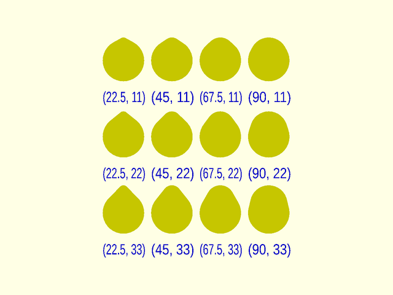

 

**Arguments:** 

<abbr title="These args can be used by position or by name.">By&nbsp;Position</abbr> | What it does
-------------------- | ------------
`diameter`           | shaft diameter in mm
`length`             | length in mm
`distorted`          | true/false should this be distorted
`body_color`         | color in which to render the shaft if rendered as a positive, color of the cut surfaces if rendering as a negative.

<abbr title="These args must be used by name, ie: name=value">By&nbsp;Name</abbr> | What it does
-------------------- | ------------
`$unf_hdist_x`       | width of distortion as a percentage of the diameter (0-100)
`$unf_hdist_y`       | height of distortion as a percentage of the diameter (0-100)

---

### Module: distortion\_test\_block

**Synopsis:** Shaft Distortion Test Block

**Usage:** 

- distortion_test_block(diameter, depth, steps, min_spacing, min_dist_x, max_dist_x, min_dist_y, max_dist_y, include_control, body_color, subtraction_color)

**Description:** 

Render a block with a series of distorted bolt shafts with varying values of unf_hdist_x and unf_hdist_y for choosing the best values to use with a particular setup.

**Figure 2.2.1:** 

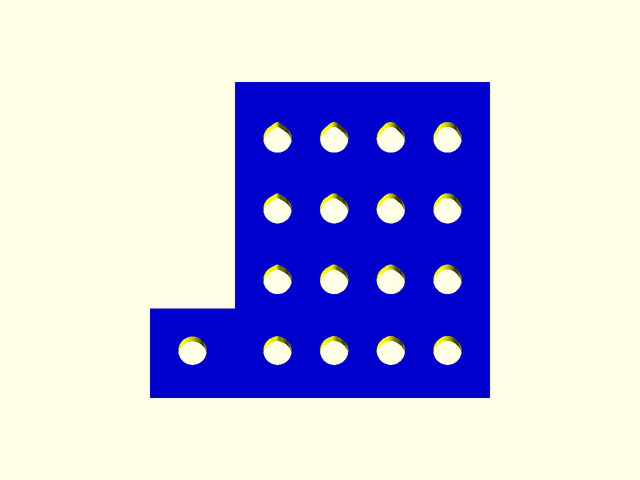

 

**Arguments:** 

<abbr title="These args can be used by position or by name.">By&nbsp;Position</abbr> | What it does
-------------------- | ------------
`diameter`           | shaft diameter
`depth`              | thickness of the block
`steps`              | number of rows, columns
`min_spacing`        | minimum spacing between holes
`min_dist_x`         | minimum unf_hdist_x to try
`max_dist_x`         | maximum unf_hdist_x to try
`min_dist_y`         | minimum unf_hdist_y to try
`max_dist_y`         | maximum unf_hdist_y to try
`body_color`         | color of the block
`subtraction_color`  | color of the surfaces cut into the block by the test holes

---

## Section: Cap Bolts - unf\_cap\_*

The vector representing a cap bolt will consist of, in order:
* name
* bolt_diameter
* head_diameter
* head_height
* default_length

### Function: unf\_cap\_v

**Synopsis:** Cap Head Bolt Vector

**Usage:** 

- unf_cap_v(size_or_vector)

**Description:** 

Retrieve a vector representing the dimensions of a cap-head bolt given the size. Will return the passed parameter if passed a vector. Thus sizes and dimension vectors may be treated interchangably.

**Arguments:** 

<abbr title="These args can be used by position or by name.">By&nbsp;Position</abbr> | What it does
-------------------- | ------------
`size`               | size as a string or the vector itself

---

### Function: unf\_cap\_head\_diameter

**Synopsis:** Cap Head Bolt Clearance Diameter

**Usage:** 

- unf_cap_head_diameter(size_or_vector)

**Description:** 

Retrieve the diameter in mm of the head of a cap-head bolt given the size.

**Arguments:** 

<abbr title="These args can be used by position or by name.">By&nbsp;Position</abbr> | What it does
-------------------- | ------------
`size`               | size as a string or the unf_cap_v() vector itself

---

### Function: unf\_cap\_head\_height

**Synopsis:** Cap Head Bolt Head Height

**Usage:** 

- unf_cap_head_height(size_or_vector)

**Description:** 

Retrieve the height or thickness in mm of the head of a cap-head bolt given the size.

**Arguments:** 

<abbr title="These args can be used by position or by name.">By&nbsp;Position</abbr> | What it does
-------------------- | ------------
`size`               | size as a string or the unf_cap_v() vector itself

---

### Function: unf\_cap\_default\_length

**Synopsis:** Cap Head Bolt Default Length

**Usage:** 

- unf_cap_default_length(size_or_vector)

**Description:** 

Retrieve a default length for a cap head bolt given it's size. Probably not very useful in a real design, good for picking a length to demonstrate an example of a unf_cap bolt.

**Arguments:** 

<abbr title="These args can be used by position or by name.">By&nbsp;Position</abbr> | What it does
-------------------- | ------------
`size`               | size as a string or the unf_cap_v() vector itself

---

### Module: unf\_cap

**Synopsis:** Cap Head Bolt

**Usage:** 

- unf_cap(size, length, head_ext, distorted, $unf_hdist_x, $unf_hdist_y, body_color)

**Description:** 

Render a negative for a shaft and/or head-recess for a cap-head bolt. Note, the cap head is rendered as a simple cylinder with the diameter of the widest part of the actual head. This is because it is meant for being a negative, to recess a bolt and not for printing an actual bolt.

**Figure 3.5.1:** note - the head\_ext area is semi-transparent.

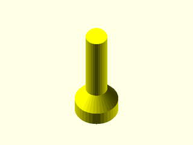

 

**Arguments:** 

<abbr title="These args can be used by position or by name.">By&nbsp;Position</abbr> | What it does
-------------------- | ------------
`size`               | string representing the size or the unf_cap_v() vector.
`length`             | length in mm
`head_ext`           | length in mm to recess the head beyond just it's thickness
`distorted`          | true/false, should the bolt hole be distorted
`body_color`         | color in which to render the bolt if rendered as a positive, color of the cut surfaces if rendering as a negative.

<abbr title="These args must be used by name, ie: name=value">By&nbsp;Name</abbr> | What it does
-------------------- | ------------
`$unf_hdist_x`       | width of distortion as a percentage of the diameter (0-100)
`$unf_hdist_y`       | height of distortion as a percentage of the diameter (0-100)

---

## Section: Countersunk Bolts - unf\_csk\_*

The vector representing a countersunk bolt will consist of, in order:
* name
* bolt_diameter
* head_diameter
* head_height
* default_length

### Function: unf\_csk\_v

**Synopsis:** Counter Sunk Bolt Vector

**Usage:** 

- unf_csk_v(size_or_vector)

**Description:** 

Retrieve a vector representing the dimensions of a countersunk bolt given the size. Will return the passed parameter if passed a vector. Thus sizes and dimension vectors may be treated interchangably.

**Arguments:** 

<abbr title="These args can be used by position or by name.">By&nbsp;Position</abbr> | What it does
-------------------- | ------------
`size`               | size as a string or the vector itself

---

### Function: unf\_csk\_head\_diameter

**Synopsis:** Countersunk Head Clearance Diameter

**Usage:** 

- unf_csk_head_diameter(size_or_vector)

**Description:** 

Retrieve the diameter in mm of the head of a countersunk bolt given the size.

**Arguments:** 

<abbr title="These args can be used by position or by name.">By&nbsp;Position</abbr> | What it does
-------------------- | ------------
`size`               | size as a string or the unf_csk_v() vector itself

---

### Function: unf\_csk\_head\_height

**Synopsis:** Countersunk Head Height

**Usage:** 

- unf_csk_head_height(size_or_vector)

**Description:** 

Retrieve the height or thickness in mm of the head of a countersunk bolt given the size.

**Arguments:** 

<abbr title="These args can be used by position or by name.">By&nbsp;Position</abbr> | What it does
-------------------- | ------------
`size`               | size as a string or the unf_csk_v() vector itself

---

### Function: unf\_csk\_default\_length

**Synopsis:** Countersunk Bolt Default Length

**Usage:** 

- unf_csk_default_length(size_or_vector)

**Description:** 

Retrieve a default length for a countersunk bolt given it's size. Probably not very useful in a real design, good for picking a length to demonstrate an example of a unf_csk bolt.

**Arguments:** 

<abbr title="These args can be used by position or by name.">By&nbsp;Position</abbr> | What it does
-------------------- | ------------
`size`               | size as a string or the unf_csk_v() vector itself

---

### Module: unf\_csk

**Synopsis:** Countersunk Bolt

**Usage:** 

- unf_csk(size, length, head_ext, distorted, body_color)

**Description:** 

Render a negative for a shaft and/or head-recess for a countersunk bolt.

**Figure 4.5.1:** note - the head\_ext area is semi-transparent.

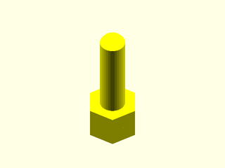

  

**Arguments:** 

<abbr title="These args can be used by position or by name.">By&nbsp;Position</abbr> | What it does
-------------------- | ------------
`size`               | string representing the size or the unf_csk_v() vector.
`length`             | length in mm
`head_ext`           | length in mm to recess the head beyond just it's thickness
`distorted`          | true/false, should the bolt hole be distorted
`body_color`         | color in which to render the bolt if rendered as a positive, color of the cut surfaces if rendering as a negative.

<abbr title="These args must be used by name, ie: name=value">By&nbsp;Name</abbr> | What it does
-------------------- | ------------
`$unf_hdist_x`       | width of distortion as a percentage of the diameter (0-100)
`$unf_hdist_y`       | height of distortion as a percentage of the diameter (0-100)

---

## Section: Hex Head Bolts - unf\_hex\_*

The vector representing a hex head bolt will consist of, in order:
* name
* bolt_diameter
* head_diameter
* head_height
* default_length

### Function: unf\_hex\_v

**Synopsis:** Hex Head Bolt Vector

**Usage:** 

- unf_hex_v(size_or_vector)

**Description:** 

Retrieve a vector representing the dimensions of a hex-head bolt given the size. Will return the passed parameter if passed a vector. Thus sizes and dimension vectors may be treated interchangably.

**Arguments:** 

<abbr title="These args can be used by position or by name.">By&nbsp;Position</abbr> | What it does
-------------------- | ------------
`size`               | size as a string or the vector itself

---

### Function: unf\_hex\_head\_diameter

**Synopsis:** Hex Head Bolt Clearance Diameter

**Usage:** 

- unf_hex_head_diameter(size_or_vector)

**Description:** 

Retrieve the diameter in mm of the head of a hex-head bolt given the size.

**Arguments:** 

<abbr title="These args can be used by position or by name.">By&nbsp;Position</abbr> | What it does
-------------------- | ------------
`size`               | size as a string or the unf_hex_v() vector itself

---

### Function: unf\_hex\_head\_height

**Synopsis:** Hex Head Height

**Usage:** 

- unf_hex_head_height(size_or_vector)

**Description:** 

Retrieve the height or thickness in mm of the head of a hex-head bolt given the size.

**Arguments:** 

<abbr title="These args can be used by position or by name.">By&nbsp;Position</abbr> | What it does
-------------------- | ------------
`size`               | size as a string or the unf_hex_v() vector itself

---

### Function: unf\_hex\_default\_length

**Synopsis:** Hex Head Bolt Default Length

**Usage:** 

- unf_hex_default_length(size_or_vector)

**Description:** 

Retrieve a default length for a hex head bolt given it's size. Probably not very useful in a real design, good for picking a length to demonstrate an example of a unf_hex bolt.

**Arguments:** 

<abbr title="These args can be used by position or by name.">By&nbsp;Position</abbr> | What it does
-------------------- | ------------
`size`               | size as a string or the unf_hex_v() vector itself

---

### Module: unf\_hex

**Synopsis:** Hex Head Bolt

**Usage:** 

- unf_hex(size, length, head_ext, distorted, body_color)

**Description:** 

Render a negative for a shaft and/or head-recess for a hex-head bolt.

**Figure 5.5.1:** note - the head\_ext area is semi-transparent.

  

**Arguments:** 

<abbr title="These args can be used by position or by name.">By&nbsp;Position</abbr> | What it does
-------------------- | ------------
`size`               | string representing the size or the unf_hex_v() vector.
`length`             | length in mm
`head_ext`           | length in mm to recess the head beyond just it's thickness
`distorted`          | true/false, should the bolt hole be distorted
`body_color`         | color in which to render the bolt if rendered as a positive, color of the cut surfaces if rendering as a negative.

<abbr title="These args must be used by name, ie: name=value">By&nbsp;Name</abbr> | What it does
-------------------- | ------------
`$unf_hdist_x`       | width of distortion as a percentage of the diameter (0-100)
`$unf_hdist_y`       | height of distortion as a percentage of the diameter (0-100)

---

## Section: Self Tapping Screws - unf\_stp\_*

Self tapping screws for plastic. These need two different holes. The part being clamped gets a clearance hole, just wide enough for the screw to slide in and out without the threads biting, plus a recess for the head. The part being screwed into gets a pilot hole, narrow enough that the threads cut into the plastic and hold tight but not so narrow that the plastic splits.

Pilot holes may be star shaped rather than round. The plastic displaced by the threads then has somewhere to go between the points instead of pushing outward on the surrounding wall. The points are spaced according to $unf_nozzle so they are not so fine that they just print smooth. The inner and outer diameters of the star are set as a percentage of the thread depth above the root (minor) diameter by $unf_stp_pilot_id and $unf_stp_pilot_od. A round pilot hole is made at the average of the two.

Metric sizes ("M3", "ST2.9", etc...) use ISO 1478 thread dimensions, ISO 273 fine clearance holes and ISO 7049, 7050, 7051, 1481, 1479, 7053, 7380-1 and 7380-2 head dimensions. Numbered and inch sizes ("#6", "1/4"", etc...) use ASME B18.6.4 and B18.6.3 dimensions and ASME close fit clearance holes. Head styles which have no ISO standard use the ASME dimensions for metric sizes too, flange_button has no ASME standard so it uses the ISO dimensions for all sizes. Sizes not in the tables are interpolated by diameter. None of these have been verified against real screws yet.

Available head styles, in the negative these are all rendered as either a cylinder or a cone. Self tapping screws turn as they are driven so even hex heads get a round recess.
* "pan"
* "csk" (or "flat", "countersunk")
* "raised_csk" (or "oval", "raised_countersunk")
* "cheese" (or "fillister")
* "button"
* "flange_button" (or "flanged_button") - button head with a built in washer
* "round"
* "truss"
* "binding"
* "wafer" (or "modified_truss") - no standard, typical proportions
* "hex"
* "hex_washer"

The vector representing a self tapping screw will consist of, in order:
* name
* size
* head_diameter
* thread_diameter (major)
* head_height
* default_length
* head_style
* head_shape ("cyl" or "cone")
* minor_diameter
* clearance_diameter
* pitch

### Function: unf\_stp\_v

**Synopsis:** Self Tapping Screw Vector

**Usage:** 

- unf_stp_v(size_or_vector, [head])

**Description:** 

Retrieve a vector representing the dimensions of a self tapping screw given the size and head style. Will return the passed parameter if passed a vector. Thus sizes and dimension vectors may be treated interchangably.

**Arguments:** 

<abbr title="These args can be used by position or by name.">By&nbsp;Position</abbr> | What it does
-------------------- | ------------
`size`               | size as a string or the vector itself
`head`               | head style, see the section description for the list ("pan")

---

### Function: unf\_stp\_head\_style

**Synopsis:** Self Tapping Screw Head Style

**Usage:** 

- unf_stp_head_style(head_or_vector)

**Description:** 

Takes a vector describing a self tapping screw or a head style name and returns the normalized head style name. Aliases such as "flat" or "oval" are converted to "csk" and "raised_csk".

**Arguments:** 

<abbr title="These args can be used by position or by name.">By&nbsp;Position</abbr> | What it does
-------------------- | ------------
`in`                 | head style as a string or the unf_stp_v() vector itself

---

### Function: unf\_stp\_head\_shape

**Synopsis:** Self Tapping Screw Head Shape

**Usage:** 

- unf_stp_head_shape(head_or_vector)

**Description:** 

Takes a vector describing a self tapping screw or a head style name and returns the shape used for the head recess, "cone" for countersunk heads, otherwise "cyl".

**Arguments:** 

<abbr title="These args can be used by position or by name.">By&nbsp;Position</abbr> | What it does
-------------------- | ------------
`in`                 | head style as a string or the unf_stp_v() vector itself

---

### Function: unf\_stp\_is\_imperial

**Synopsis:** Is this a numbered or inch size

**Usage:** 

- unf_stp_is_imperial(size)

**Description:** 

Returns true if the size string is a numbered ("#6") or inch ("1/4"") size, which use ASME tables, false for metric sizes which use ISO tables.

**Arguments:** 

<abbr title="These args can be used by position or by name.">By&nbsp;Position</abbr> | What it does
-------------------- | ------------
`in`                 | size as a string

---

### Function: unf\_stp\_inch

**Synopsis:** Convert a table in inches to mm

**Usage:** 

- unf_stp_inch(table)

**Description:** 

Multiplies every value in a table of rows by 25.4. Lets the ASME tables be written in inches as published.

**Arguments:** 

<abbr title="These args can be used by position or by name.">By&nbsp;Position</abbr> | What it does
-------------------- | ------------
`t`                  | table, a list of rows of numbers in inches

---

### Function: unf\_stp\_lookup

**Synopsis:** Self Tapping Screw Table Lookup

**Usage:** 

- unf_stp_lookup(size, iso, asme, [col])

**Description:** 

Look up a dimension by thread diameter from the ISO table for metric sizes or the ASME table for numbered and inch sizes, interpolating if the size is not in the table. Tables are lists of rows in mm, the first column being the thread diameter.

**Arguments:** 

<abbr title="These args can be used by position or by name.">By&nbsp;Position</abbr> | What it does
-------------------- | ------------
`in`                 | size as a string
`iso`                | table for metric sizes
`asme`               | table for numbered and inch sizes
`col`                | column of the table holding the wanted dimension (1)

---

### Function: unf\_stp\_head\_table

**Synopsis:** Self Tapping Screw Head Table

**Usage:** 

- unf_stp_head_table(head, imperial)

**Description:** 

Returns a table of head dimensions for a head style. Each row is [thread diameter, head diameter, head height] in mm. Head diameter is the widest part of the head, across the corners or the washer face for hex heads, the theoretical sharp diameter for countersunk heads.

**Arguments:** 

<abbr title="These args can be used by position or by name.">By&nbsp;Position</abbr> | What it does
-------------------- | ------------
`head`               | head style
`imperial`           | true for the ASME table, false for the ISO table

---

### Function: unf\_stp\_head\_diameter

**Synopsis:** Self Tapping Screw Head Clearance Diameter

**Usage:** 

- unf_stp_head_diameter(size_or_vector, [head])

**Description:** 

Retrieve the diameter in mm of the head of a self tapping screw given the size and head style.

**Arguments:** 

<abbr title="These args can be used by position or by name.">By&nbsp;Position</abbr> | What it does
-------------------- | ------------
`in`                 | size as a string or the unf_stp_v() vector itself
`head`               | head style ("pan")

---

### Function: unf\_stp\_head\_height

**Synopsis:** Self Tapping Screw Head Height

**Usage:** 

- unf_stp_head_height(size_or_vector, [head])

**Description:** 

Retrieve the height or thickness in mm of the head of a self tapping screw given the size and head style. For a raised countersunk head this is just the countersunk part, the raised dome stands above the surface.

**Arguments:** 

<abbr title="These args can be used by position or by name.">By&nbsp;Position</abbr> | What it does
-------------------- | ------------
`in`                 | size as a string or the unf_stp_v() vector itself
`head`               | head style ("pan")

---

### Function: unf\_stp\_default\_length

**Synopsis:** Self Tapping Screw Default Length

**Usage:** 

- unf_stp_default_length(size_or_vector)

**Description:** 

Retrieve a default length for a self tapping screw given it's size. Probably not very useful in a real design, good for picking a length to demonstrate an example of a unf_stp screw.

**Arguments:** 

<abbr title="These args can be used by position or by name.">By&nbsp;Position</abbr> | What it does
-------------------- | ------------
`in`                 | size as a string or the unf_stp_v() vector itself

---

### Function: unf\_stp\_minor\_diameter

**Synopsis:** Self Tapping Screw Minor Diameter

**Usage:** 

- unf_stp_minor_diameter(size_or_vector)

**Description:** 

Retrieve the minor (root) diameter in mm of the threads of a self tapping screw given the size.

**Arguments:** 

<abbr title="These args can be used by position or by name.">By&nbsp;Position</abbr> | What it does
-------------------- | ------------
`in`                 | size as a string or the unf_stp_v() vector itself

---

### Function: unf\_stp\_clearance\_diameter

**Synopsis:** Self Tapping Screw Clearance Hole Diameter

**Usage:** 

- unf_stp_clearance_diameter(size_or_vector)

**Description:** 

Retrieve the diameter in mm of a hole a self tapping screw will slide through without the threads biting, given the size.

**Arguments:** 

<abbr title="These args can be used by position or by name.">By&nbsp;Position</abbr> | What it does
-------------------- | ------------
`in`                 | size as a string or the unf_stp_v() vector itself

---

### Function: unf\_stp\_pitch

**Synopsis:** Self Tapping Screw Thread Pitch

**Usage:** 

- unf_stp_pitch(size_or_vector)

**Description:** 

Retrieve the thread pitch in mm of a self tapping screw given the size. Used to leave room for the tip of the screw at the bottom of a pilot hole.

**Arguments:** 

<abbr title="These args can be used by position or by name.">By&nbsp;Position</abbr> | What it does
-------------------- | ------------
`in`                 | size as a string or the unf_stp_v() vector itself

---

### Function: unf\_stp\_engagement

**Synopsis:** Self Tapping Screw Recommended Engagement

**Usage:** 

- unf_stp_engagement(size_or_vector)

**Description:** 

Retrieve a recommended depth in mm of thread engagement into plastic, twice the thread diameter. Useful as a minimum depth for a pilot hole or boss.

**Arguments:** 

<abbr title="These args can be used by position or by name.">By&nbsp;Position</abbr> | What it does
-------------------- | ------------
`in`                 | size as a string or the unf_stp_v() vector itself

---

### Function: unf\_default\_nozzle

**Synopsis:** Printer Nozzle Diameter

**Usage:** 

- unf_default_nozzle()

**Description:** 

Returns $unf_nozzle if it is set, otherwise 0.4.

---

### Function: unf\_stp\_default\_pilot\_id

**Synopsis:** Default Star Pilot Inner Diameter Percentage

**Usage:** 

- unf_stp_default_pilot_id()

**Description:** 

Returns $unf_stp_pilot_id if it is set, otherwise 0, the root of the threads.

---

### Function: unf\_stp\_default\_pilot\_od

**Synopsis:** Default Star Pilot Outer Diameter Percentage

**Usage:** 

- unf_stp_default_pilot_od()

**Description:** 

Returns $unf_stp_pilot_od if it is set, otherwise 50, half way up the threads.

---

### Function: unf\_stp\_pilot\_id

**Synopsis:** Self Tapping Screw Star Pilot Inner Diameter

**Usage:** 

- unf_stp_pilot_id(size_or_vector, [id_percent])

**Description:** 

Retrieve the inner diameter in mm, the dips between the points, of a star shaped pilot hole.

**Arguments:** 

<abbr title="These args can be used by position or by name.">By&nbsp;Position</abbr> | What it does
-------------------- | ------------
`in`                 | size as a string or the unf_stp_v() vector itself
`id_percent`         | percentage of the thread depth above the minor diameter ($unf_stp_pilot_id)

---

### Function: unf\_stp\_pilot\_od

**Synopsis:** Self Tapping Screw Star Pilot Outer Diameter

**Usage:** 

- unf_stp_pilot_od(size_or_vector, [od_percent])

**Description:** 

Retrieve the outer diameter in mm, the points, of a star shaped pilot hole.

**Arguments:** 

<abbr title="These args can be used by position or by name.">By&nbsp;Position</abbr> | What it does
-------------------- | ------------
`in`                 | size as a string or the unf_stp_v() vector itself
`od_percent`         | percentage of the thread depth above the minor diameter ($unf_stp_pilot_od)

---

### Function: unf\_stp\_pilot\_diameter

**Synopsis:** Self Tapping Screw Round Pilot Diameter

**Usage:** 

- unf_stp_pilot_diameter(size_or_vector, [id_percent], [od_percent])

**Description:** 

Retrieve the diameter in mm of a round pilot hole, the average of the star inner and outer diameters.

**Arguments:** 

<abbr title="These args can be used by position or by name.">By&nbsp;Position</abbr> | What it does
-------------------- | ------------
`in`                 | size as a string or the unf_stp_v() vector itself
`id_percent`         | star inner diameter as a percentage of the thread depth above the minor diameter ($unf_stp_pilot_id)
`od_percent`         | star outer diameter as a percentage of the thread depth above the minor diameter ($unf_stp_pilot_od)

---

### Function: unf\_stp\_star\_points

**Synopsis:** Self Tapping Screw Star Pilot Point Count

**Usage:** 

- unf_stp_star_points(size_or_vector, [od_percent])

**Description:** 

Retrieve the number of points for a star shaped pilot hole. Points are spaced at least 2.5 nozzle widths apart around the outer diameter so they don't just print smooth. Never less than 3.

**Arguments:** 

<abbr title="These args can be used by position or by name.">By&nbsp;Position</abbr> | What it does
-------------------- | ------------
`in`                 | size as a string or the unf_stp_v() vector itself
`od_percent`         | star outer diameter as a percentage of the thread depth above the minor diameter ($unf_stp_pilot_od)

<abbr title="These args must be used by name, ie: name=value">By&nbsp;Name</abbr> | What it does
-------------------- | ------------
`$unf_nozzle`        | printer nozzle diameter in mm

---

### Module: unf\_stp\_pilot

**Synopsis:** Self Tapping Screw Pilot Hole

**Usage:** 

- unf_stp_pilot(size, length, star, chamfer, tip, ext, id_percent, od_percent, body_color)

**Description:** 

Render a negative for the pilot hole a self tapping screw threads into. The hole starts at the origin and goes up along the z axis.

**Figure 6.22.1:** note - the ext area is semi-transparent.

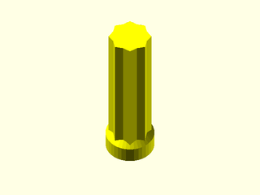

  

**Arguments:** 

<abbr title="These args can be used by position or by name.">By&nbsp;Position</abbr> | What it does
-------------------- | ------------
`size`               | string representing the size or the unf_stp_v() vector.
`length`             | depth in mm of thread engagement, defaults to unf_stp_engagement()
`star`               | true/false, star shaped or round pilot hole
`chamfer`            | true/false, chamfer the mouth of the hole out to the thread diameter so the plastic doesn't bulge up around the screw
`tip`                | true/false, deepen the hole by two thread pitches to leave room for the tip of the screw
`ext`                | length in mm to extend the hole above the origin
`id_percent`         | star inner diameter as a percentage of the thread depth above the minor diameter ($unf_stp_pilot_id)
`od_percent`         | star outer diameter as a percentage of the thread depth above the minor diameter ($unf_stp_pilot_od)
`body_color`         | color of the cut surfaces

<abbr title="These args must be used by name, ie: name=value">By&nbsp;Name</abbr> | What it does
-------------------- | ------------
`$unf_nozzle`        | printer nozzle diameter in mm, sets the spacing of the star points
`$unf_stp_pilot_id`  | default for id_percent
`$unf_stp_pilot_od`  | default for od_percent

---

### Module: unf\_stp

**Synopsis:** Self Tapping Screw

**Usage:** 

- unf_stp(size, head, length, clearance_length, head_ext, star, chamfer, tip, distorted, id_percent, od_percent, body_color)

**Description:** 

Render a negative for a head recess, clearance hole and optionally a pilot hole for a self tapping screw. Like the bolts, the head sits at the origin and the shaft goes up along the z axis for length beyond the head. The first clearance_length of that is a clearance hole for the part being clamped, the rest is a pilot hole for the part being screwed into. Leave clearance_length at -1 for a clearance hole all the way through.

**Figure 6.23.1:** Pan head, star pilot. note - the head\_ext area is semi-transparent.

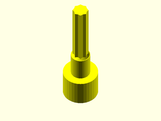

 

**Figure 6.23.2:** Countersunk head, round pilot. note - the head\_ext area is semi-transparent.

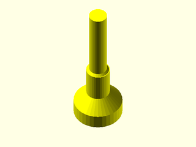

 

**Arguments:** 

<abbr title="These args can be used by position or by name.">By&nbsp;Position</abbr> | What it does
-------------------- | ------------
`size`               | string representing the size or the unf_stp_v() vector.
`head`               | head style, ignored if size is a vector ("pan")
`length`             | length in mm beyond the head
`clearance_length`   | length in mm of clearance hole before the pilot hole begins, -1 for no pilot hole
`head_ext`           | length in mm to recess the head beyond just it's thickness
`star`               | true/false, star shaped or round pilot hole
`chamfer`            | true/false, chamfer the mouth of the pilot hole
`tip`                | true/false, deepen the pilot hole by two thread pitches to leave room for the tip of the screw
`distorted`          | true/false, should the clearance hole be distorted, the pilot hole never is
`id_percent`         | star inner diameter as a percentage of the thread depth above the minor diameter ($unf_stp_pilot_id)
`od_percent`         | star outer diameter as a percentage of the thread depth above the minor diameter ($unf_stp_pilot_od)
`body_color`         | color in which to render the screw if rendered as a positive, color of the cut surfaces if rendering as a negative.

<abbr title="These args must be used by name, ie: name=value">By&nbsp;Name</abbr> | What it does
-------------------- | ------------
`$unf_hdist_x`       | width of distortion as a percentage of the diameter (0-100)
`$unf_hdist_y`       | height of distortion as a percentage of the diameter (0-100)
`$unf_nozzle`        | printer nozzle diameter in mm, sets the spacing of the star points
`$unf_stp_pilot_id`  | default for id_percent
`$unf_stp_pilot_od`  | default for od_percent

---

## Section: Heatset Inserts - unf\_hst\_*

The vector representing a heatset insert will contain, in order:
* name
* shaft_diameter
* insert_diameter
* length

note - these are pilot hole dimensions, not dimensions of the actual insert

### Function: unf\_hst\_v

**Synopsis:** Heatset Insert Vector

**Usage:** 

- unf_hst_v(size_or_vector)

**Description:** 

Retrieve a vector representing the dimensions of a heatset insert given the size. Will return the passed parameter if passed a vector. Thus sizes and dimension vectors may be treated interchangably.

**Arguments:** 

<abbr title="These args can be used by position or by name.">By&nbsp;Position</abbr> | What it does
-------------------- | ------------
`size`               | size as a string or the vector itself

---

### Function: unf\_hst\_diameter

**Synopsis:** Heatset Insert Diameter

**Usage:** 

- unf_hst_diameter(size_or_vector)

**Description:** 

Retrieve the diameter in mm of the hole for a heatset insert given the size.

**Arguments:** 

<abbr title="These args can be used by position or by name.">By&nbsp;Position</abbr> | What it does
-------------------- | ------------
`size`               | size as a string or the unf_hst_v() vector itself

---

### Function: unf\_hst\_length

**Synopsis:** Heatset Insert Length

**Usage:** 

- unf_hst_length(size_or_vector, [length])

**Description:** 

Retrieve the length in mm of the hole for a heatset insert given the size.

**Arguments:** 

<abbr title="These args can be used by position or by name.">By&nbsp;Position</abbr> | What it does
-------------------- | ------------
`size`               | size as a string or the unf_hst_v() vector itself
`length`             | "small", "medium" or "large", or a number to just return that number ("medium")

---

### Module: unf\_hst

**Synopsis:** Heatset Insert

**Usage:** 

- unf_hst(size, opening_taper_percent, length, head_ext, extra_room, bolt_hole_depth, body_color)

**Description:** 

Render a negative for a heatset-insert hole.

**Figure 7.4.1:** note - the head\_ext, extra\_room and bolt shaft areas are semi-transparent.

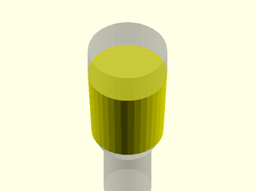

 

**Arguments:** 

<abbr title="These args can be used by position or by name.">By&nbsp;Position</abbr> | What it does
-------------------- | ------------
`size`               | string representing the size or the unf_hst_v() vector.
`opening_taper_percent` | enlarge the opening with a taper for ease of insertion.
`length`             | Heatset inserts for the same bolt size do come in a variety of lenghts. Fortunately, because when using them one is melting into the plastic it is not necessary to be 100% accurate. For this field use one of small, medium or large to get holes for smaller to larger heatset inserts respectively.
`head_ext`           | length in mm to recess the head beyond just it's thickness
`extra_room`         | Continue the hole, at the inserts outer dimension a bit farther into the part. This creates a space for molten plastic to flow to when inserting the insert.
`bolt_hole_depth`    | Extend the hole at the width of the bolt, not the width of the insert beyond the insert to make room for the bolt to pass through the insert and deeper into the hole.
`body_color`         | color in which to render the insert if rendered as a positive, color of the cut surfaces if rendering as a negative.

---

## Section: Hex Nut - unf\_nut\_*

The vector representing a hex nut will contain, in order:
* name
* nut_diameter
* height

### Function: unf\_nut\_v

**Synopsis:** hex-nut vector

**Usage:** 

- unf_nut_v(size_or_vector)

**Description:** 

Retrieve a vector representing the dimensions of a hex-nut bolt given the size. Will return the passed parameter if passed a vector. Thus sizes and dimension vectors may be treated interchangably.

**Arguments:** 

<abbr title="These args can be used by position or by name.">By&nbsp;Position</abbr> | What it does
-------------------- | ------------
`size`               | size as a string or the vector itself

---

### Function: unf\_nut\_diameter

**Synopsis:** Hex Nut Clearance Diameter

**Usage:** 

- unf_nut_diameter(size)

**Description:** 

Takes a fastener size or a hex nut vector and returns the clearance diameter

---

### Function: unf\_nut\_small\_d

**Synopsis:** Hex Nut distance across flats

**Usage:** 

- unf_nut_small_d(size_or_vector)

**Description:** 

Retrieve the distance across flats of a typical hex nut given the bolt size.

**Arguments:** 

<abbr title="These args can be used by position or by name.">By&nbsp;Position</abbr> | What it does
-------------------- | ------------
`size`               | size as a string or the unf_nut_v() vector itself

---

### Function: unf\_nut\_height

**Synopsis:** Hex Nut Height

**Usage:** 

- unf_nut_height(size_or_vector)

**Description:** 

Retrieve the height (thickness) of a typical hex nut given the bolt size.

**Arguments:** 

<abbr title="These args can be used by position or by name.">By&nbsp;Position</abbr> | What it does
-------------------- | ------------
`size`               | size as a string or the unf_nut_v() vector itself

---

### Module: unf\_nut

**Synopsis:** Hex Nut

**Usage:** 

- unf_nut(size, ext, body_color)

**Description:** 

Render a negative for a hex nut hole.

**Figure 8.5.1:** note - the ext area is semi-transparent.

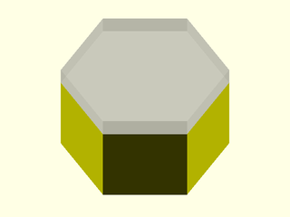

  

**Arguments:** 

<abbr title="These args can be used by position or by name.">By&nbsp;Position</abbr> | What it does
-------------------- | ------------
`size`               | string representing the size or the unf_nut_v() vector.
`ext`                | length in mm to recess the nut beyond just it's thickness
`body_color`         | color in which to render the nut if rendered as a positive, color of the cut surfaces if rendering as a negative.

---

## Section: Square Nut - unf\_sqr\_*

The vector representing a square nut shall contain, in order:
* name
* size
* diagonal (widest part)
* shaft_diameter
* height
* side_length

### Function: unf\_sqr\_v

**Synopsis:** Square Nut Vector

**Usage:** 

- unf_sqr_v(size_or_vector)

**Description:** 

Retrieve a vector representing the dimensions of a square nut given the size. Will return the passed parameter if passed a vector. Thus sizes and dimension vectors may be treated interchangably.

**Arguments:** 

<abbr title="These args can be used by position or by name.">By&nbsp;Position</abbr> | What it does
-------------------- | ------------
`size`               | size as a string or the vector itself

---

### Function: unf\_sqr\_length

**Synopsis:** Square Nut Side Length

**Usage:** 

- unf_sqr_length(size_or_vector)

**Description:** 

Retrieve the length of a side of a square nut.

**Arguments:** 

<abbr title="These args can be used by position or by name.">By&nbsp;Position</abbr> | What it does
-------------------- | ------------
`size`               | size as a string or the unf_sqr_v() vector itself

---

### Function: unf\_sqr\_height

**Synopsis:** Square Nut Height / Thickness

**Usage:** 

- unf_sqr_height(size_or_vector)

**Description:** 

Retrieve the thickness of a square nut, it's height when lying flat.

**Arguments:** 

<abbr title="These args can be used by position or by name.">By&nbsp;Position</abbr> | What it does
-------------------- | ------------
`size`               | size as a string or the unf_sqr_v() vector itself

---

### Module: unf\_sqr

**Synopsis:** Square Nut

**Usage:** 

- unf_sqr(size, ext, body_color)

**Description:** 

Render a negative for a square shaped nut

**Figure 9.4.1:** note - the ext area is semi-transparent.

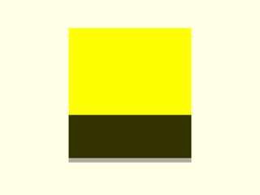

  

**Arguments:** 

<abbr title="These args can be used by position or by name.">By&nbsp;Position</abbr> | What it does
-------------------- | ------------
`size`               | string representing the size or the unf_sqr_v() vector.
`ext`                | Extra height added to the negative for recessing the nut.
`body_color`         | color in which to render the nut if rendered as a positive, color of the cut surfaces if rendering as a negative.

---

## Section: Washer unf\_wsh\_*

The vector representing a washer will consist of, in order:
* name
* washer_diameter
* height

### Function: unf\_wsh\_v

**Synopsis:** Washer Vector

**Usage:** 

- unf_wsh_v(size_or_vector)

**Description:** 

Retrieve a vector representing the dimensions of a washer given the size. Will return the passed parameter if passed a vector. Thus sizes and dimension vectors may be treated interchangably.

**Arguments:** 

<abbr title="These args can be used by position or by name.">By&nbsp;Position</abbr> | What it does
-------------------- | ------------
`size`               | size as a string or the vector itself

---

### Function: unf\_wsh\_diameter

**Synopsis:** Washer Clearance Diameter

**Usage:** 

- unf_wsh_diameter(size_or_vector)

**Description:** 

Retrieve the outer diameter in mm of a washer given the bolt size.

**Arguments:** 

<abbr title="These args can be used by position or by name.">By&nbsp;Position</abbr> | What it does
-------------------- | ------------
`size`               | size as a string or the unf_wsh_v() vector itself

---

### Function: unf\_wsh\_height

**Synopsis:** Washer Thickness (height lying flat)

**Usage:** 

- unf_wsh_height(size_or_vector)

**Description:** 

Retrieve the height or thickness in mm of a washer given the bolt size.

**Arguments:** 

<abbr title="These args can be used by position or by name.">By&nbsp;Position</abbr> | What it does
-------------------- | ------------
`size`               | size as a string or the unf_wsh_v() vector itself

---

### Module: unf\_wsh

**Synopsis:** Washer

**Usage:** 

- unf_wsh(size, ext, body_color)

**Description:** 

Render a negative for a washer. Does not include a bolt hole since it is only meant to be a negative for recessing a vitamin, not an actual printed washer.

**Figure 10.4.1:** note - the head\_ext area is semi-transparent.

  

**Arguments:** 

<abbr title="These args can be used by position or by name.">By&nbsp;Position</abbr> | What it does
-------------------- | ------------
`size`               | string representing the size or the unf_wsh_v() vector.
`ext`                | length in mm to recess the washer beyond just it's thickness
`body_color`         | color in which to render the washer if rendered as a positive, color of the cut surfaces if rendering as a negative.

---

## Section: Pillar

### Module: unf\_pillar\_pos

**Synopsis:** Render the positive part of a fastener pillar

**Usage:** 

- unf_pillar_pos(fastener, bolt, heatset_length, length, slope, wall, body_color)

**Description:** 

*Still under Construction* Calculates the diameter needed for a support pillar that will contain a heatset insert or a nut. Then render the positive part of the pillar.

**Figure 11.1.1:** 

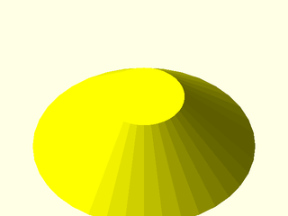

 

**Arguments:** 

<abbr title="These args can be used by position or by name.">By&nbsp;Position</abbr> | What it does
-------------------- | ------------
`fastener`           | A string representing the type of fastener that will be contained within the pillar. One of "heatset" or "hexnut". Future support will be added for "squarenut".
`bolt`               | A string representing the bolt size.
`heatset_length`     | One of "small", "medium" or "large" used only with a heatset insert.
`length`             | length in mm of the pillar
`slope`              | slope in degrees leading from bottom to top of the pillar. *note - future version will use a bezier curve, likely replacing this argument.*
`wall`               | Minimum material thickness between heatset or nut insert and the outside of the pillar.
`body_color`         | color in which to render the pillar.

---

### Module: unf\_pillar\_neg

**Synopsis:** Render the negative part of a fastener pillar

**Usage:** 

- unf_pillar_neg(fastener, bolt, length, heatset_length, wall, ext, body_color)

**Description:** 

*Still under Construction* Render that which should be subtracted from a pillar so that fasteners may be added.

**Figure 11.2.1:** Heatset Insert

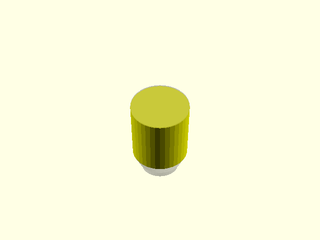

 

**Figure 11.2.2:** Hexnut

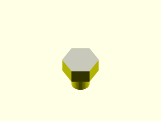

 

**Arguments:** 

<abbr title="These args can be used by position or by name.">By&nbsp;Position</abbr> | What it does
-------------------- | ------------
`fastener`           | A string representing the type of fastener that will be contained within the pillar. One of "heatset" or "hexnut". Future support will be added for "squarenut".
`bolt`               | A string representing the bolt size.
`length`             | length in mm of the pillar
`heatset_length`     | One of "small", "medium" or "large" used only with a heatset insert.
`wall`               | Minimum material thickness between heatset or nut insert and the outside of the pillar.
`ext`                | length in mm to recess the fastener beyond just it's length
`body_color`         | color in which to render if rendered as a positive, color of the cut surfaces if rendering as a negative.

---

### Module: unf\_pillar

**Synopsis:** Render a fastener pillar

**Usage:** 

- unf_pillar_neg(fastener, heatset_length, bolt, length, slope, wall, body_color, subtraction_color)

**Description:** 

*Still under Construction* Render a pillar which will contain a heatset insert or nut and a bolt hole.

**Figure 11.3.1:** Heatset Insert

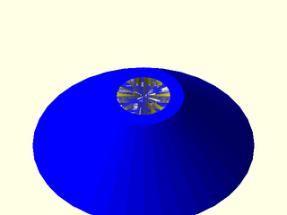

 

**Figure 11.3.2:** Hexnut

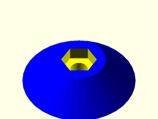

 

**Arguments:** 

<abbr title="These args can be used by position or by name.">By&nbsp;Position</abbr> | What it does
-------------------- | ------------
`fastener`           | A string representing the type of fastener that will be contained within the pillar. One of "heatset" or "hexnut". Future support will be added for "squarenut".
`heatset_length`     | One of "small", "medium" or "large" used only with a heatset insert.
`bolt`               | A string representing the bolt size.
`length`             | length in mm of the pillar
`slope`              | slope in degrees leading from bottom to top of the pillar. *note - future version will use a bezier curve, likely replacing this argument.*
`wall`               | Minimum material thickness between heatset or nut insert and the outside of the pillar.
`body_color`         | color in which to render the pillar
`subtraction_color`  | color in which to render the cut surfaces of the pillar.

---

## Section: Licensing

UnfyOpenSCADLib is free software: you can redistribute it and/or modify it under the terms of the
GNU General Public License as published by the Free Software Foundation, either version 3 of
the License, or (at your option) any later version.

UnfyOpenSCADLib is distributed in the hope that it will be useful, but WITHOUT ANY WARRANTY;
without even the implied warranty of MERCHANTABILITY or FITNESS FOR A PARTICULAR PURPOSE.
See the GNU General Public License for more details.

You should have received a copy of the GNU General Public License along with UnfyOpenSCADLib.
If not, see <https://www.gnu.org/licenses/>.

