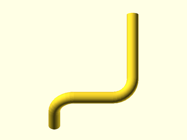
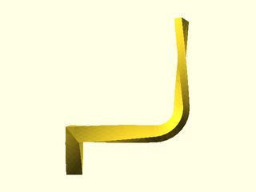

# LibFile: unfy\_path.scad

UnfyOpenSCADLib Copyright Leif Burrow 2026
kc8rwr@unfy.us
unforgettability.net

This file is part of UnfyOpenSCADLib.

unfy_path contains modules for sweeping 2d shapes along a path.

Written with help from Claude (Anthropic)

## File Contents

- [`unf_path_extrude`](#module-unf_path_extrude) – Sweep a 2d child along a polyline

2. [Section: Licensing](#section-licensing)

### Module: unf\_path\_extrude

**Synopsis:** Sweep a 2d child along a polyline

**Usage:** 

- unf_path_extrude(path, &lt;args&gt;) child2d();

**Description:** 

Sweep a 2D child along a polyline that starts at the origin.

Orientation: the child starts in the XY plane at the origin, as with linear_extrude, and is turned to face the first segment with its X axis kept horizontal (if the first segment is straight up, nothing turns). At each corner it is rotated about the axis of that turn, so its orientation is carried along the path without any added roll.

Fillets: with no twist and no scale, each filleted corner is an exact rotate_extrude. With twist or scale, arcs are cut into straight mitered pieces; the piece count is what $fn/$fa/$fs would give a full circle of that radius, times (turn angle / 360).

Twist and scale are spread over the total path length, arcs included.

Limits:
* Non-uniform scale combined with twist is only approximate at joints.
* The module can't see the child's size, so it can't check that a fillet radius exceeds the profile's reach toward the inside of the turn. Too small a radius makes rotate_extrude fail (no twist/scale) or produces self-intersecting geometry (twist/scale).

All helpers are defined inside unf_path_extrude(), so they are private to it.

**Arguments:** 

<abbr title="These args can be used by position or by name.">By&nbsp;Position</abbr> | What it does
-------------------- | ------------
`path`               | [[x,y,z], [x,y,z,r], ...] Points to extrude to, in order. The extrusion always starts at [0,0,0]. The optional 4th value is the fillet radius for the corner at that point; 0 or omitted gives a sharp, mitered corner. The last point's radius is ignored.

<abbr title="These args must be used by name, ie: name=value">By&nbsp;Name</abbr> | What it does
-------------------- | ------------
`twist`              | Total twist in degrees over the whole path. Same sense as linear_extrude (left-hand rule about the direction of travel). (0)
`scale`              | Scale at the end of the path: a number or [sx, sy]. Applied linearly with distance along the path. (1)
`profile_r`          | Upper bound on how far the 2D child reaches from its origin. Only used to size the cuts for mitered joints. It must be at least the real value, or sharp corners will have gaps. Keep it close to the real value when using twist or scale through fillets: a much larger value can leave hairline internal voids (CGAL reports extra "Volumes") from the oversized cuts. (100)

**Figure 1.1.1:** filleted corners

 

**Figure 1.1.2:** twist=180, profile\_r=5

 

---

## Section: Licensing

UnfyOpenSCADLib is free software: you can redistribute it and/or modify it under the terms of the
GNU General Public License as published by the Free Software Foundation, either version 3 of
the License, or (at your option) any later version.

UnfyOpenSCADLib is distributed in the hope that it will be useful, but WITHOUT ANY WARRANTY;
without even the implied warranty of MERCHANTABILITY or FITNESS FOR A PARTICULAR PURPOSE.
See the GNU General Public License for more details.

You should have received a copy of the GNU General Public License along with UnfyOpenSCADLib.
If not, see <https://www.gnu.org/licenses/>.

