# LibFile: unfy\_shapes.scad

UnfyOpenSCADLib Copyright Leif Burrow 2026
kc8rwr@unfy.us
unforgettability.net

This file is part of UnfyOpenSCADLib.

unfy_shapes contains a collection of modules for generating geometric shapes with an emphasis on rounded corners and edges.

## File Contents

- [`unf_roundedRectangle`](#module-unf_roundedrectangle)
- [`unf_roundedCuboid`](#module-unf_roundedcuboid)
- [`unf_roundedCylinder`](#module-unf_roundedcylinder)
- [`unf_oval`](#module-unf_oval)
- [`unf_star`](#module-unf_star)
- [`unf_tube`](#module-unf_tube)
- [`unf_bezierWedge2d`](#module-unf_bezierwedge2d)
- [`unf_bezierWedge3d`](#module-unf_bezierwedge3d)
- [`unf_bezierFrustum`](#module-unf_bezierfrustum)
- [`unf_mountTab`](#module-unf_mounttab)

2. [Section: Licensing](#section-licensing)

### Module: unf\_roundedRectangle

**Usage:** 

- unf_roundedRectangle(<args>);

**Description:** 

Creates a 2d rectangle with rounded corners.

Corners too large to fit along their sides are reduced to fit, where both corners on a side are too large they shrink in proportion.

**Arguments:** 

<abbr title="These args can be used by position or by name.">By&nbsp;Position</abbr> | What it does
-------------------- | ------------
`size`               | may be a 2d vector [x, y] or a single number creating a square equivalent to [x, x] ([18, 5])
`corners`            | a vector containing the radiuses of each rounded corner (0 for no-rounding) [(0, 0), (x, 0), (x, y), (0, y)] or a single number to make all corners the same ([1, 1, 1, 1])

**Figure 1.1.1:** defaults

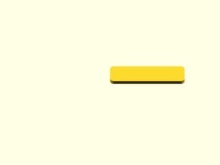

  

**Figure 1.1.2:** custom

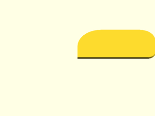

  

---

### Module: unf\_roundedCuboid

**Usage:** 

- unf_roundedCuboid(<args>);

**Description:** 

Creates a 3d cuboid with rounded corners.

Where rounded edges meet a rounded corner the corner radius shrinks along with the edge so the two blend. Opposite edge radiuses together may not exceed that side's length, and the largest top edge radius plus the largest bottom edge radius may not exceed size.z.

Optionally the cuboid may be bent around a cylinder of radius bend_r whose axis passes through the origin perpendicular to bend_plane. The cuboid's distance along bend_plane[0] becomes distance around the cylinder (0 at the top, positive going clockwise when viewed down the axis), its distance along bend_plane[1] becomes extra distance outward from the cylinder's surface, and its distance along the axis is unchanged. With the default plane a cuboid lying along x bends into a rainbow over the origin, with [[0, 1, 0], [0, 0, 1]] a cuboid lying along y arches over the x axis like a bridge. A negative bend_r bends the other way, wrapping the cuboid around the inside of the cylinder.

The cuboid is built as a single polyhedron. Corners too large to fit along their sides are reduced to fit, where both corners on a side are too large they shrink in proportion.

**Arguments:** 

<abbr title="These args can be used by position or by name.">By&nbsp;Position</abbr> | What it does
-------------------- | ------------
`size`               | may be a 3d vector [x, y, z] or a single number creating a cube equivalent to [x, x, x] ([20, 10, 5])
`corners`            | a vector containing the radiuses of each rounded corner ordered [[0,0], [x,0], [x,y], [0,y]] or a single number making all corners the same ([1, 1, 1, 1])
`edge_r`             | an 8-dimensional vector containing the radiuses of each rounded edge [FT, RT, BT, LT, FB, RB, BB, LB], or 4-dim [F, R, B, L], 2-dim [T, B], or single number ([1, 2, 1, 2, 1, 2, 1, 2])
`bend_r`             | radius of the cylinder to bend around, 0 for no bend (0)
`bend_plane`         | 2 vectors [along, up] defining the plane the cuboid bends in, along is wrapped around the cylinder, up points away from it and need not be exactly perpendicular to along ([[1, 0, 0], [0, 1, 0]])

**Figure 1.2.1:** defaults

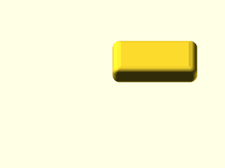

  

**Figure 1.2.2:** custom

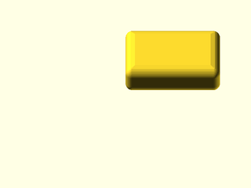

  

**Figure 1.2.3:** bent into a rainbow

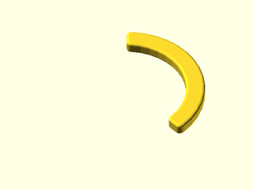

 

**Figure 1.2.4:** bent into a bridge

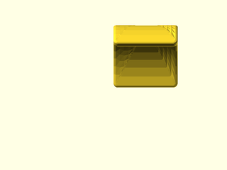

 

---

### Module: unf\_roundedCylinder

**Usage:** 

- unf_roundedCylinder(<args>);

**Description:** 

Creates a cylinder with rounded top and/or bottom edges.

**Arguments:** 

<abbr title="These args can be used by position or by name.">By&nbsp;Position</abbr> | What it does
-------------------- | ------------
`r`                  | radius of cylinder (0)
`d`                  | diameter of cylinder (0)
`r1`                 | bottom radius (0)
`r2`                 | top radius (0)
`d1`                 | bottom diameter (0)
`d2`                 | top diameter (0)
`h`                  | height of cylinder (1)
`edge_r`             | general edge radius for both ends (0)
`edge1_r`            | bottom edge radius (0)
`edge2_r`            | top edge radius (0)

**Figure 1.3.1:** defaults

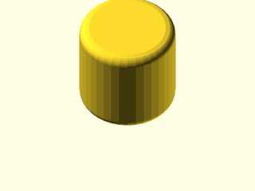

  

**Figure 1.3.2:** custom

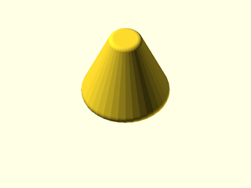

  

---

### Module: unf\_oval

**Usage:** 

- unf_oval(<args>);

**Description:** 

Draw an oval by size.

**Arguments:** 

<abbr title="These args can be used by position or by name.">By&nbsp;Position</abbr> | What it does
-------------------- | ------------
`size`               | 2d vector [x, y] for oval dimensions ([8, 4])

**Figure 1.4.1:** defaults

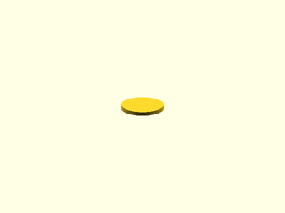

  

**Figure 1.4.2:** custom

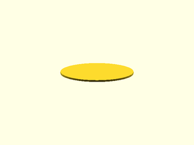

  

---

### Module: unf\_star

**Usage:** 

- unf_star(<args>);

**Description:** 

Draws a 2d star centered on the origin with its first point straight up along the y axis. The points touch a circle of diameter od and the dips between them touch a circle of diameter id.

**Arguments:** 

<abbr title="These args can be used by position or by name.">By&nbsp;Position</abbr> | What it does
-------------------- | ------------
`od`                 | outer diameter, of the circle around the points (20)
`id`                 | inner diameter, of the circle around the dips between the points, must not exceed od (10)
`p`                  | number of points, a whole number of at least 2 (5)

**Figure 1.5.1:** defaults

  

**Figure 1.5.2:** custom

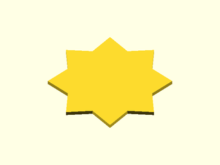

  

---

### Module: unf\_tube

**Usage:** 

- unf_tube(<args>);

**Description:** 

Creates a hollow cylinder standing on the origin along the z axis, od wide with an id wide opening through its length.

The opening may be given directly as id or by the wall thickness w, in which case id = od - (2 * w). If both are given they must agree. If neither is given the wall is 1.245 thick. Where that leaves no opening, the wall being half of od or more, a solid cylinder od wide is made instead.

**Arguments:** 

<abbr title="These args can be used by position or by name.">By&nbsp;Position</abbr> | What it does
-------------------- | ------------
`od`                 | outer diameter (15.875)
`id`                 | inner diameter, 0 to use w or the default wall (0)
`w`                  | wall thickness, only used when id is 0 (0)
`l`                  | length (50)

**Figure 1.6.1:** defaults

  

**Figure 1.6.2:** custom

  

---

### Module: unf\_bezierWedge2d

**Usage:** 

- unf_bezierWedge2d(<args>);

**Description:** 

Sort of a right-triangle but the hypotenuse is a bezier curve pulled in rather than a straight line. Good for inside-corners.

**Arguments:** 

<abbr title="These args can be used by position or by name.">By&nbsp;Position</abbr> | What it does
-------------------- | ------------
`size`               | a 2d vector [x, y] or a single number ([5, 15])
`v`                  | a vector to affect the shape of the bezier curve (false)

**Figure 1.7.1:** defaults

  

**Figure 1.7.2:** custom

  

---

### Module: unf\_bezierWedge3d

**Usage:** 

- unf_bezierWedge3d(<args>);

**Description:** 

A 3-dimensional wedge shape, fits inside a right-angle with a bezier curve along the hypotenuse.

**Arguments:** 

<abbr title="These args can be used by position or by name.">By&nbsp;Position</abbr> | What it does
-------------------- | ------------
`size`               | a 3d vector [x, y, z] or a single number ([5, 15, 15])
`rounded_edges`      | vector or number for edge rounding ([1, 1])

**Figure 1.8.1:** defaults

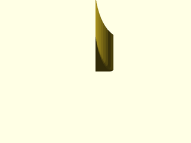

  

**Figure 1.8.2:** custom

  

---

### Module: unf\_bezierFrustum

**Usage:** 

- unf_bezierFrustum(<args>);

**Description:** 

Creates a 3D frustum shaped object transitioning via bezier curves with optional edge rounding.

**Arguments:** 

<abbr title="These args can be used by position or by name.">By&nbsp;Position</abbr> | What it does
-------------------- | ------------
`base_d`             | uniform base diameter (0)
`base_dx`            | base x dimension (80)
`base_dy`            | base y dimension (60)
`base_edge_r`        | base edge rounding radius (0)
`end_d`              | uniform end diameter (0)
`end_dx`             | end x dimension (20)
`end_dy`             | end y dimension (40)
`end_edge_r`         | end edge rounding radius (0)
`control_height_pct` | height percentage for bezier control point (50)
`control_pinch_pct`  | pinch percentage for bezier control point (50)
`length`             | total length along z axis (300)

**Figure 1.9.1:** defaults

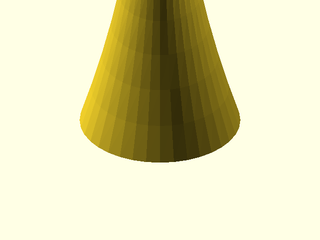

 

---

### Module: unf\_mountTab

**Usage:** 

- unf_mountTab(<args>);

**Description:** 

Creates a mounting tab with an integrated bolt hole, washer recess, and reinforcing web supports.

**Arguments:** 

<abbr title="These args can be used by position or by name.">By&nbsp;Position</abbr> | What it does
-------------------- | ------------
`tab_length`         | length dimension of the mounting tab
`tab_height`         | thickness/height of the tab
`bolt_d`             | diameter of the bolt hole
`washer_v`           | washer definition vector for the recess
`wall`               | wall thickness parameter

**Figure 1.10.1:** sample

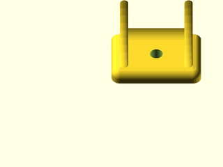

 

---

## Section: Licensing

UnfyOpenSCADLib is free software: you can redistribute it and/or modify it under the terms of the
GNU General Public License as published by the Free Software Foundation, either version 3 of
the License, or (at your option) any later version.

UnfyOpenSCADLib is distributed in the hope that it will be useful, but WITHOUT ANY WARRANTY;
without even the implied warranty of MERCHANTABILITY or FITNESS FOR A PARTICULAR PURPOSE.
See the GNU General Public License for more details.

You should have received a copy of the GNU General Public License along with UnfyOpenSCADLib.
If not, see <https://www.gnu.org/licenses/>.

